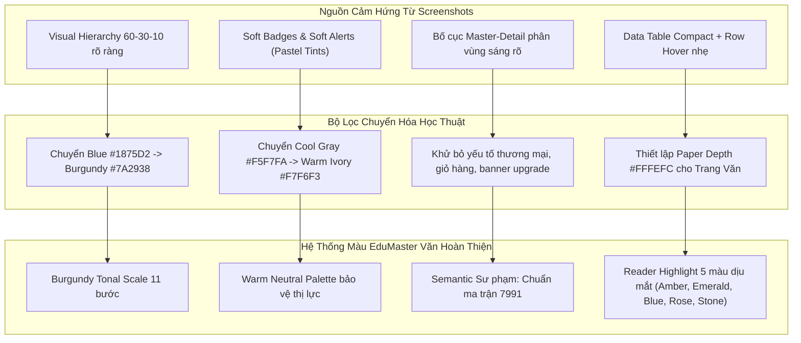

# BÁO CÁO PHÂN TÍCH CHUYÊN SÂU THIẾT KẾ MÀU SẮC (COLOR DESIGN AUDIT & ANALYSIS)
## BỘ ẢNH THAM CHIẾU GIAO DIỆN TẠI `docs/screenshots/` (48 ẢNH)
**Dự án:** EduMaster-Literature (Hệ thống Thiết kế Bài dạy & Khảo thí Ngữ văn THPT)  
**Tài liệu phân tích:** 48 ảnh chụp màn hình UI thực tế tại thư mục [screenshots](file:///D:/Workspace/Other/Pj%20AI/EduMaster-Literature/docs/screenshots/)  
**Vai trò phân tích:** Principal Design Systems Architect & Senior Product Designer  
**Thời gian hoàn thành:** Tháng 10/2026  

---

## 1. TỔNG QUAN HỆ THỐNG MÀU SẮC TRONG BỘ ẢNH SCREENSHOTS

Bộ ảnh gồm 48 ảnh giao diện được chụp từ hệ thống nền tảng **Edusta / Stack Admin** — một template giao diện giáo dục trực tuyến và bàn làm việc quản trị (Modern LMS & Creator Dashboard) xây dựng trên nền tảng Bootstrap 4 / Material Design.

```
+---------------------------------------------------------------------------------------+
|  TopBar: Cobalt Blue (#1875D2) - Điểm neo thị giác trên cùng                         |
+-------------------+-------------------------------------------------------------------+
| Dark Sidebar      | Canvas Nền: Cool Gray (#F5F7FA)                                   |
| Slate Charcoal    |                                                                   |
| (#262F36)         |  +------------------------+  +---------------------------------+  |
|                   |  | Card Trắng (#FFFFFF)   |  | Card Trắng (#FFFFFF)            |  |
| - Text Muted Xám  |  | - Title: Đen than      |  | - Soft Badges / Alerts          |  |
| - Active Badge    |  | - Accent: Xanh/Lá/Vàng |  | - Border: Mảnh (#E9ECEF)        |  |
|   Vàng/Xanh       |  +------------------------+  +---------------------------------+  |
+-------------------+-------------------------------------------------------------------+
```

### 1.1. Bản chất và Tinh thần Thị giác Nguyên bản
- **Phong cách chủ đạo:** *Modern EdTech SaaS / Developer Workspace*.
- **Cảm xúc mang lại:** Năng động, tốc độ, định hướng công nghệ cao (Tech-forward), dứt khoát và thiên về các ngành lập trình / kinh doanh trực tuyến.
- **Tông màu cảm quan (Temperature):** Nghiêng hẳn về **Tone lạnh (Cool Tone)** với sự áp đảo của dải xanh dương (Cobalt/Royal Blue) và xám ghi mát (Cool Gray/Slate).

### 1.2. Thống kê Phân bổ Tỷ lệ Màu sắc (Quy tắc 60 - 30 - 10)
Quan sát tổng quan trên toàn bộ 48 ảnh, hệ thống áp dụng rất bài bản tỷ lệ phối màu kinh điển:
1. **60% - Màu Nền Chủ Đạo (Dominant Background):**
   - Canvas tổng thể của trang web sử dụng màu xám sáng nhạt pha sắc xanh lạnh (`#F5F7FA` hoặc `#F4F6F9`).
   - Bề mặt các thẻ chứa nội dung (Card Surfaces), cửa sổ bật lên (Modal), menu phụ dùng màu trắng tinh khiết (`#FFFFFF`).
   - Tác dụng: Tạo chiều sâu phân tầng rõ rệt giữa sàn thao tác (canvas) và các khối thông tin (cards), giúp màn hình nhiều dữ liệu nhưng không bị rối rắm.
2. **30% - Cấu trúc Định hình & Phân cấp (Structural Hierarchy):**
   - Thanh điều hướng trên cùng (TopBar) tràn viền với màu xanh Cobalt đậm (`#1875D2`).
   - Thanh điều hướng bên trái (Left Sidebar) sử dụng màu đen than đá tối (`#262F36` / `#212529`).
   - Hệ thống văn bản (Typography): Tiêu đề dùng đen than đậm (`#212529`), nội dung văn bản dùng xám than (`#495057`), nhãn phụ xám vừa (`#6C757D`).
   - Tác dụng: Khung sườn bao bọc không gian làm việc vững chắc, giữ cho mắt người dùng luôn định vị được trục điều hướng trung tâm.
3. **10% - Điểm Nhấn Tương Tác & Ngữ Nghĩa (Visual Accent & Semantics):**
   - Màu nút bấm hành động (Primary CTA buttons), liên kết active, thanh tiến độ.
   - Các huy hiệu trạng thái (Status Badges) và thông báo (Alerts) đa sắc: Xanh lá cây (Success), Vàng tươi (Warning/Pending), Đỏ tươi (Danger/High Priority), Xanh mây/Cyan (Info).

---

## 2. BẢNG BÓC TÁCH MÃ MÀU CHI TIẾT (COLOR PALETTE INVENTORY & TOKENS)

Dưới đây là bảng trích xuất chi tiết toàn bộ các mã màu thực tế xuất hiện trong 48 ảnh chụp màn hình, được phân loại theo chức năng giao diện:

| Nhóm Màu | Tên Token Nhận Diện | Mã HEX | Mã RGB | Tỷ Lệ Xuất Hiện & Ứng Dụng Trong Screenshots | Ảnh Minh Họa Điển Hình |
| :--- | :--- | :--- | :--- | :--- | :--- |
| **Primary Blue** | `brand-blue-600` | `#1875D2` | `rgb(24, 117, 210)` | **Màu thương hiệu chính:** Nền thanh TopBar, nút Primary mặc định, active tab, đường biểu đồ line chart, FAB settings ở góc dưới phải. | `001`, `003`, `018`, `033`, `045` |
| | `brand-blue-700` | `#12589E` | `rgb(18, 88, 158)` | Trạng thái Hover của nút bấm chính, viền active input. | `003`, `014` |
| | `brand-blue-50` | `#E8F4FD` | `rgb(232, 244, 253)` | Nền Soft Alert Primary, nền badge pill nhạt, trạng thái selected hàng trong bảng. | `004`, `010`, `045` |
| | `brand-blue-100` | `#D0E7FA` | `rgb(208, 231, 250)` | Viền mảnh của thẻ thông báo mềm Primary. | `004` |
| **Dark Nav** | `dark-sidebar-bg` | `#262F36` | `rgb(38, 47, 54)` | Nền toàn bộ Sidebar trái (chế độ Full Sidebar), mang sắc than pha xanh đá. | `018`, `025`, `044` |
| | `dark-sidebar-hover` | `#1E252B` | `rgb(30, 37, 43)` | Trạng thái hover trên danh mục menu điều hướng Sidebar. | `018`, `020` |
| | `dark-card-banner` | `#2B303A` | `rgb(43, 48, 58)` | Banner đầu thẻ khóa học trong thư viện bài giảng. | `025`, `031` |
| **Neutrals** | `canvas-bg` | `#F5F7FA` | `rgb(245, 247, 250)` | Canvas nền của toàn bộ ứng dụng, sáng nhưng không bị lóa như trắng tuyệt đối. | Tất cả 48 ảnh |
| | `surface-card` | `#FFFFFF` | `rgb(255, 255, 255)` | Bề mặt các thẻ Card, Panel, Modal Dialog, Input fields. | Tất cả 48 ảnh |
| | `surface-subtle` | `#F8FAFC` | `rgb(248, 250, 252)` | Nền tiêu đề bảng dữ liệu (Table Header), dải xám phân tách section. | `010`, `038`, `044` |
| | `border-light` | `#E9ECEF` | `rgb(233, 236, 239)` | Đường viền chuẩn 1px của Card, bảng, đường gạch ngang chia tách dữ liệu. | `001`, `010`, `014` |
| | `border-strong` | `#CED4DA` | `rgb(206, 212, 218)` | Viền ô nhập liệu Input mặc định, viền nút Secondary. | `003`, `014` |
| | `text-heading` | `#212529` | `rgb(33, 37, 41)` | Tiêu đề lớn (Page Title, Card Header, Modal Title). Đen than, tránh màu `#000000` gắt. | Tất cả 48 ảnh |
| | `text-body` | `#495057` | `rgb(73, 80, 87)` | Nội dung chính của bài viết, nhãn form, danh sách dữ liệu. | `014`, `033`, `045` |
| | `text-muted` | `#6C757D` | `rgb(108, 117, 125)` | Siêu dữ liệu phụ (Metadata), ngày tháng, số lượt xem, placeholder form. | `001`, `010`, `047` |
| **Success** | `success-green` | `#28A745` | `rgb(40, 167, 69)` | Nút `+ New Course`, nút `Submit` trong Quiz, huy hiệu "RESOLVED" vé hỗ trợ, điểm "Great 9.8". | `003`, `034`, `039`, `048` |
| | `success-soft-bg` | `#D4EDDA` | `rgb(212, 237, 218)` | Nền thông báo thành công dịu (Soft Alert Success), nền badge xanh nhạt. | `004`, `024` |
| | `success-soft-text` | `#155724` | `rgb(21, 87, 36)` | Màu chữ trong thông báo thành công mềm (đảm bảo tương phản cao). | `004` |
| **Warning** | `warning-amber` | `#FFC107` | `rgb(255, 193, 7)` | Nút `Upgrade` trên banner, badge số đếm menu, điểm "Good 5.8", sao đánh giá 5 sao. | `001`, `003`, `018`, `025` |
| | `warning-banner-bg`| `#FFFBEA` | `rgb(255, 251, 234)` | Dải banner nhắc nhở gia hạn ở đầu Dashboard. | `002`, `018`, `022` |
| | `warning-soft-bg` | `#FFF3CD` | `rgb(255, 243, 205)` | Nền thông báo cảnh báo dịu (Soft Alert Warning), badge "NEED HELP". | `004`, `048` |
| | `warning-soft-text`| `#856404` | `rgb(133, 100, 4)` | Màu chữ cảnh báo mềm trên nền vàng nhạt. | `004` |
| **Danger** | `danger-red` | `#DC3545` | `rgb(220, 53, 69)` | Nút Danger xóa/hủy, điểm "Failed 2.8", badge mức độ "HIGH" trên thẻ Trello. | `003`, `004`, `018`, `048` |
| | `danger-soft-bg` | `#F8D7DA` | `rgb(248, 215, 218)` | Nền thông báo lỗi dịu (Soft Alert Danger). | `004` |
| | `danger-soft-text` | `#721C24` | `rgb(114, 28, 36)` | Màu chữ thông báo lỗi trên nền hồng phấn nhạt. | `004` |
| **Info / Cyan** | `info-cyan` | `#17A2B8` | `rgb(23, 162, 184)` | Nút Info phụ, thanh đo kỹ năng HTML/CSS, nhãn Cloud Hosting. | `003`, `004`, `018` |
| | `info-soft-bg` | `#D1ECF1` | `rgb(209, 236, 241)` | Nền thông báo thông tin dịu (Soft Alert Info). | `004` |
| | `info-soft-text` | `#0C5460` | `rgb(12, 84, 96)` | Chữ thông tin màu xanh cổ vịt đậm trên nền xanh phấn. | `004` |

---

## 3. PHÂN TÍCH QUY TẮC & KỸ THUẬT PHỐI MÀU TRONG BỘ SCREENSHOTS

### 3.1. Mô hình Phối màu & Cân bằng Nhiệt độ Thị giác
1. **Phối màu Bổ túc Bán phần (Split-Complementary):**
   - Màu chủ đạo xanh dương (`#1875D2`) được đối trọng bởi hai sắc thái ấm nóng: Vàng cam Amber (`#FFC107`) và Đỏ san hô (`#DC3545`).
   - Sự kết hợp này tạo ra độ tương phản năng động cao, rất bắt mắt đối với các nền tảng học tập trực tuyến đại chúng.
2. **Kỹ thuật Cân bằng Ấm - Lạnh (Cool-Warm Balancing):**
   - Không gian tổng thể được "làm lạnh" bởi TopBar xanh lam và Sidebar đen than để tạo cảm giác trật tự, sạch sẽ, công nghệ.
   - Các điểm tương tác người dùng (User Action Points) được "sưởi ấm" bằng các gam màu nóng: Nút vàng kêu gọi nâng cấp, các thanh tiến độ màu vàng/xanh lá, các thẻ điểm thi. Nhờ đó, người dùng lập tức hướng mắt vào khu vực cần thao tác mà không bị lạc giữa vô vàn số liệu.

### 3.2. Kỹ thuật Đổ màu: Sự Tiến hóa từ Solid sang "Soft System" (Pastel Tints)
Một trong những giá trị thiết kế đắt giá nhất được bộc lộ trong ảnh [004_fixed-ui-alerts.png](file:///D:/Workspace/Other/Pj%20AI/EduMaster-Literature/docs/screenshots/004_fixed-ui-alerts.png) và [010_fixed-ui-tables.png](file:///D:/Workspace/Other/Pj%20AI/EduMaster-Literature/docs/screenshots/010_fixed-ui-tables.png) là sự phân biệt rõ ràng giữa hai phong cách:

```
[Phong cách Cũ: Solid Alerts / Flat Badges]
+-------------------------------------------------------+
|  NỀN MÀU ĐẶC SẬC SỠ (Vàng chóe / Xanh đặc / Đỏ chói)  | -> Gây căng thẳng mắt,
|  Chữ trắng đè lên nền đặc                             |    chiếm đoạt visual focus
+-------------------------------------------------------+

                     VS

[Phong cách Hiện đại: Soft Alerts / Soft Pastel Badges]
+-------------------------------------------------------+
|  Nền mờ pastel 10-15% (Tint pha loãng êm dịu)         | -> Tinh tế, thanh lịch,
|  Chữ cùng tone màu nhưng độ bão hòa cao (Dark Shade)  |    bảo toàn độ tương phản
|  Viền mỏng 1px tinh xảo                               |    WCAG AA mà không chói
+-------------------------------------------------------+
```

- **Cơ chế Soft Tint:**
  - Nền lấy từ 10% đến 15% opacity của màu gốc pha với nền trắng.
  - Chữ bên trong lấy sắc độ tối (Dark Shade) cùng tone màu với độ bão hòa cao (ví dụ: nền xanh nhạt `#D4EDDA` đi với chữ xanh rừng đậm `#155724`).
  - Viền mỏng 1px màu trung gian giúp khối hiển thị sắc nét, không bị nhòe vào nền trắng của Card.
- **Lợi ích thực tế:** Giảm thiểu triệt để hiện tượng "nhiễu thị giác" (Visual Noise), cho phép nhiều thẻ trạng thái xuất hiện cùng lúc trên một màn hình mà không biến giao diện thành "bảng màu xiếc".

### 3.3. Phân tầng Thị giác Bằng Màu sắc (Visual Elevation by Color)
Hệ thống sử dụng màu sắc để thiết lập 3 tầng cấu trúc:
- **Tầng 0 (Background Horizon):** Màu `#F5F7FA` - mặt phẳng xa nhất.
- **Tầng 1 (Content Surfaces):** Màu `#FFFFFF` với viền `#E9ECEF` và shadow rất mỏng `rgba(0,0,0,0.04)` - mặt bàn làm việc gần với người dùng hơn.
- **Tầng 2 (Interactive Elements):** Màu tương phản cao (Cobalt Blue `#1875D2` hoặc Emerald Green `#28A745`) - nổi hẳn lên trên bề mặt thẻ để mời gọi nhấp chuột.

---

## 4. ĐÁNH GIÁ ĐỘ TƯƠNG PHẢN & TIÊU CHUẨN TRUY CẬP (ACCESSIBILITY & WCAG 2.1)

Kiểm tra độ tương phản thực tế (Contrast Ratio) theo tiêu chuẩn quốc tế WCAG 2.1 (Yêu cầu: Normal Text $\ge 4.5:1$ cho chuẩn AA, $\ge 7:1$ cho chuẩn AAA; Large Text $\ge 3.0:1$):

| Cặp Màu Kiểm Tra | Vị Trí Thành Phần | Tỉ Lệ Tương Phản (Ratio) | Đánh Giá WCAG 2.1 | Phân Tích Thực Tế |
| :--- | :--- | :--- | :--- | :--- |
| Trắng `#FFFFFF` trên TopBar `#1875D2` | Text & Icon trên TopBar | **4.64 : 1** | **ĐẠT CHUẨN AA** | Vừa đủ chuẩn AA cho text thường, đạt chuẩn tốt cho icon và text in đậm. Tuy nhiên, nếu dùng font nét quá mảnh sẽ hơi khó đọc dưới ánh sáng mạnh. |
| Đen than `#212529` trên Card Trắng `#FFFFFF` | Tiêu đề Heading | **16.06 : 1** | **ĐẠT CHUẨN AAA** (Xuất sắc) | Tương phản cực kỳ rõ ràng, chữ sắc nét, đọc lâu không mỏi mắt vì đã khử bớt sắc đen thuần `#000000`. |
| Xám than `#495057` trên Card Trắng `#FFFFFF` | Nội dung văn bản Body text | **8.29 : 1** | **ĐẠT CHUẨN AAA** | Độ tương phản lý tưởng cho việc đọc các đoạn văn dài. |
| Xám vừa `#6C757D` trên Card Trắng `#FFFFFF` | Nhãn phụ, Metadata | **4.68 : 1** | **ĐẠT CHUẨN AA** | Vừa chạm ngưỡng chuẩn AA. Phù hợp làm thông tin phụ trợ. |
| Trắng `#FFFFFF` trên Nút Vàng `#FFC107` | Nút Warning / Badge Vàng | **1.63 : 1** | **VI PHẠM NẶNG** (Rất lóa) | **Điểm yếu chí mạng:** Chữ trắng trên nền vàng nguyên bản gần như không thể đọc được. Trong các ảnh sau, hệ thống phải sửa bằng cách dùng chữ đen than hoặc chuyển sang Soft Badge (`#856404` trên `#FFF3CD` $\rightarrow$ 6.35:1 đạt AA). |
| Trắng `#FFFFFF` trên Nút Xanh lá `#28A745` | Nút New Course, Submit | **3.37 : 1** | **ĐẠT CHO LARGE TEXT**, Trượt AA cho text nhỏ | Chữ trắng trên xanh lá tươi hơi chói, cần text in đậm (bold) và kích thước từ 15px trở lên mới đảm bảo khả năng tiếp cận. |
| Xám sáng `#8A959E` trên Sidebar Than `#262F36` | Menu item Sidebar chưa chọn | **3.82 : 1** | **CẦN CẢI THIỆN** | Hơi tối đối với người có thị lực yếu hoặc màn hình có độ sáng thấp. |

---

## 5. ĐẶC ĐIỂM MÀU SẮC THEO TỪNG CỤM MÀN HÌNH CHỨC NĂNG

### 5.1. Cụm Dashboard Tổng quan (`001`, `002`, `018`, `044`)
- **Điểm nhấn số liệu:** Các khối Stat Cards sử dụng màu sắc gạch chân (Underline Accent) rất thanh mảnh: vàng cam cho tháng hiện tại, xanh lam cho năm, xanh lá cho tăng trưởng.
- **Biểu đồ (Charts):** Sử dụng các đường cong màu xanh lam trong suốt với các điểm neo chấm tròn (data nodes), không lạm dụng diện tích màu đặc giúp biểu đồ có cảm giác "nhẹ như mây".
- **Hàng mục xếp hạng (Rankings):** Màu sắc được triệt tiêu tối đa, nhường chỗ cho ảnh đại diện (avatar) tròn và các con số doanh thu màu đen rõ nét.

### 5.2. Cụm UI Components Thư viện (`003` đến `015`)
- **Nút bấm (Buttons):** Định nghĩa chuẩn mực 8 màu Bootstrap (Primary, Secondary, Success, Danger, Warning, Info, Light, Dark). Nổi bật là phiên bản **Outlined Buttons** (nền trong suốt, viền màu, chữ màu) tạo cảm giác thanh thoát hơn nhiều so với nút đặc truyền thống.
- **Bảng dữ liệu (Data Tables - `010`):** Kiểm soát màu sắc tuyệt vời. Toàn bộ bảng màu trắng/xám trung tính, chỉ duy nhất cột **Status** là mang các huy hiệu nhỏ màu pastel (ADMIN vàng, USER xanh lá, MANAGER xanh lam) để dẫn hướng mắt nhanh chóng.

### 5.3. Cụm Không gian Đánh giá & Khảo thí (`034`, `040`)
- **Bộ đếm thời gian (Timer):** Đặt ở góc phải với các con số to màu xanh Cobalt `#1875D2` đặt trong khung viền phân cách, tạo cảm giác cấp bách nhưng chuẩn xác.
- **Số thứ tự câu hỏi:** Thẻ câu hỏi `#9` màu xanh lam nổi bật trên nền trắng, giúp thí sinh nhận biết ngay vị trí câu hỏi đang làm.
- **Thanh điều hướng danh sách câu:** Ô câu hỏi đang làm mang màu xanh Cobalt tràn khối (Solid Fill) chữ trắng, các câu khác nền trắng viền xám mảnh.

### 5.4. Cụm Master-Detail & Đọc Toàn văn (`045_fixed-admin-emails.png`)
- **Cấu trúc 2 cột kinh điển:** Cột trái (Master List) có các item đang chọn được phủ nền xanh rất nhạt (`#E8F4FD`) kèm vạch chỉ thị. Cột phải (Detail Reader) là nền trắng tinh khiết với văn bản màu đen than.
- **Bookmark & Gắn thẻ:** Sử dụng icon ngôi sao màu vàng cam và huy hiệu tệp đính kèm màu xanh lam, tạo điểm nghỉ cho mắt người đọc.

---

## 6. ĐỐI CHIẾU SO SÁNH: BỘ SCREENSHOT THAM CHIẾU VS. EDUMASTER-LITERATURE

Việc hiểu rõ sự khác biệt bản chất giữa bộ ảnh tham chiếu và mục tiêu thực tế của EduMaster-Literature là điều kiện tiên quyết để tránh việc "sao chép máy móc":

| Tiêu Chí So Sánh | Bộ Ảnh Screenshots (`Edusta / Stack Admin`) | Hệ Sinh Thái `EduMaster-Literature` (Ngữ Văn THPT) | Đánh Giá & Quyết Định Thiết Kế |
| :--- | :--- | :--- | :--- |
| **Màu thương hiệu chính (Primary Brand)** | **Cobalt Blue (`#1875D2`)** | **Academic Burgundy (`#7A2938` / `#7C2D37`)** | **THAY ĐỔI TOÀN DIỆN:** Sắc đỏ Burgundy kinh viện mang phong vị trang trọng của giảng đường, màu mực đỏ chấm bài của thầy cô, và sự quý phái của bìa sách văn học cổ điển. Loại bỏ hoàn toàn sắc xanh tech khô cứng. |
| **Nền Canvas tổng thể** | **Cool Gray (`#F5F7FA`)** | **Warm Ivory / Academic Canvas (`#F7F6F3`)** | **THAY ĐỔI CỐT LÕI:** Chuyển từ xám lạnh sang xám ngà ấm. Khử toàn bộ ánh sáng xanh gây mỏi mắt khi giáo viên phải ngồi liên tục 4-6 tiếng soạn giáo án và đề thi. |
| **Bề mặt đọc văn bản (Reader Surface)** | Trắng thông thường (`#FFFFFF`), không có phân tầng trang sách | **Paper Surface (`#FFFEFC`)** kèm đổ bóng giấy (`shadow-paper`) và font Lora Serif | **NÂNG CẤP CHUYÊN SÂU:** Bộ môn Ngữ văn lấy "Tác phẩm & Ngữ liệu" làm trung tâm. Khu vực đọc cần tạo cảm giác như một trang sách in cao cấp, không phải một khung nhập liệu thô sơ. |
| **Hệ thống Huy hiệu (Badges)** | Phân loại quyền hệ thống (Admin, User, Pro, Free) và giá tiền ($49) | Phân loại **Thể loại** (Thơ, Truyện, Kịch), **Mức độ nhận thức** (Biết, Hiểu, Vận dụng) | **KẾ THỪA MÔ HÌNH SOFT BADGE:** Giữ nguyên quy tắc Soft Tint (nền pastel mờ 10-15% + chữ đậm) vì cực kỳ phù hợp để hiển thị các nhãn văn học tinh tế, không làm nát bố cục. |
| **Màu sắc Semantic** | Rực rỡ, năng động, thương mại (Banner Upgrade vàng, giỏ hàng xanh) | Nghiêm cẩn, sư phạm, chuẩn hóa quy chuẩn khảo thí (Bản đặc tả 7991) | **THANH LỌC SEMANTIC:** <br>- **Emerald (`#166534`):** Đạt chuẩn 10.0đ, cân bằng ma trận.<br>- **Amber (`#92400E`):** Chưa cân bằng điểm, cảnh báo thiếu số liệu.<br>- **Rose (`#991B1B`):** Vượt quá 10 điểm, lỗi nghiêm trọng.<br>- **Tuyệt đối không dùng Tím trang trí hay Cầu vồng.** |
| **Thanh điều hướng TopBar & Sidebar** | TopBar xanh rực rỡ + Sidebar đen kịt | Sidebar trắng tinh tế viền ấm + TopBar tối giản không chiếm dụng không gian | **TỐI GIẢN HÓA:** Tránh việc dùng khối màu xanh quá dày trên TopBar làm phân tán sự tập trung vào nội dung văn bản. |

---

## 7. BÀI HỌC THIẾT KẾ & ĐỀ XUẤT CHUYỂN HÓA SANG HỆ THỐNG MÀU EDUMASTER-LITERATURE

Từ việc phân tích 48 ảnh tham chiếu, dự án EduMaster-Literature đã chắt lọc và xây dựng nên hệ màu **Academic + Editorial + Premium** độc bản:



### 7.1. Bảng màu Burgundy Tonal Scale (11 Bước)
EduMaster-Literature đã kế thừa cấu trúc phân bậc tỉ mỉ từ hệ thống Bootstrap của screenshots nhưng định hình lại hoàn toàn bằng sắc đỏ Burgundy học thuật:
- `burgundy-25` (`#FDF8F8`): Nền thẻ selected rất nhẹ, highlight hàng bảng đang chọn.
- `burgundy-50` (`#FAF0F2`): Nền hover của các thẻ tương tác, nền tab active.
- `burgundy-100` (`#F5E0E4`): Nền huy hiệu mềm (Soft Badge) đặc thù môn Văn.
- `burgundy-200` (`#ECC2C9`): Đường viền hover của thẻ tương tác.
- `burgundy-600` (`#933647`): Hover cấp 1 của các liên kết học thuật.
- **`burgundy-700` (`#7A2938`): BRAND PRIMARY CHÍNH THỨC** — Màu nút bấm chính, tiêu đề phân hệ, icon active.
- `burgundy-800` (`#68222E`): Trạng thái hover của nút bấm chính.
- `burgundy-900` (`#521B24`): Trạng thái active/pressed khi người dùng bấm chuột.

### 7.2. Bảng màu Giấy Học Thuật & Nền Trung Tính Ấm (Warm Neutral Palette)
Thay thế toàn bộ sắc xám lạnh mặc định của template bằng hệ màu giấy ấm:
- **Canvas Nền Ứng Dụng:** `#F7F6F3` (Màu ngà ấm trang nhã, tương tự trang bìa tập san văn học).
- **Surface Bề Mặt:** `#FFFFFF` (Bề mặt các panel, modal, khung soạn thảo).
- **Paper Reader Surface:** `#FFFEFC` (Bề mặt giấy văn học cao cấp, kết hợp font chữ Lora).
- **Text Strong (Tiêu đề):** `#211E1C` (Đen than ấm, độ tương phản 16.4:1 chuẩn WCAG AAA).
- **Text Primary (Nội dung):** `#302C29` (Chữ nội dung êm dịu, không gây chói).
- **Text Secondary (Metadata):** `#706A65` (Nhãn phụ, chú thích YCCĐ).
- **Border Default:** `#E5E0DA` (Đường viền giấy mỏng nhẹ, tinh xảo).

### 7.3. Ứng dụng "Soft Badges" Cho Nghiệp Vụ Ngữ Văn THPT
Áp dụng trực tiếp cấu trúc Soft Badge học được từ ảnh `004` và `010` vào các bài toán chuyên môn:
- **Huy hiệu Thể loại Văn học:**
  - *Thơ:* Chữ `#6B21A8` trên nền `#FAF5FF` (Tím nhạt hoài niệm).
  - *Truyện / Tiểu thuyết:* Chữ `#0369A1` trên nền `#F0F9FF` (Xanh lam khám phá).
  - *Nghị luận / Ký:* Chữ `#7A2938` trên nền `#FAF0F2` (Burgundy học thuật).
- **Huy hiệu Mức độ Nhận thức (Khảo thí & Ma trận 7991):**
  - *Nhận biết:* Nền xanh lam nhạt `#EFF6FF`, chữ `#1E40AF`.
  - *Thông hiểu:* Nền xanh ngọc nhạt `#F0FDF4`, chữ `#166534`.
  - *Vận dụng:* Nền hổ phách nhạt `#FFFBEB`, chữ `#92400E`.
  - *Vận dụng cao:* Nền đỏ phấn nhạt `#FEF2F2`, chữ `#991B1B`.

---

## 8. KẾT LUẬN

Hệ thống 48 ảnh chụp màn hình tại `docs/screenshots/` cung cấp một tài liệu tham chiếu tuyệt vời về **kỷ luật tổ chức layout, phân tầng thị giác (Visual Elevation), và kỹ thuật tạo huy hiệu/thông báo mềm (Soft Alerts & Soft Badges)** của một nền tảng Dashboard hiện đại.

Tuy nhiên, màu sắc nguyên bản mang tính **"Tech-SaaS đại chúng"** với màu xanh Cobalt lạnh và các mảng khối màu đen kịt. Quá trình thiết kế EduMaster-Literature đã thực hiện một bước chuyển hóa xuất sắc: **giữ nguyên vẹn kỷ luật cấu trúc và chuẩn mực tương phản, nhưng thay đổi hoàn toàn "linh hồn màu sắc" sang Deep Burgundy và Warm Academic Ivory**. Sự chuyển hóa này mang lại một không gian làm việc chuyên nghiệp, ấm áp, đậm đà tính nhân văn và hoàn toàn chuẩn mực cho Giáo viên Ngữ văn THPT Việt Nam.
