# KẾ HOẠCH TRIỂN KHAI REFACTOR VÀ NÂNG CẤP UI/UX TOÀN DIỆN
## DỰ ÁN: EDUMASTER-LITERATURE (NGỮ VĂN THPT)

---

## 1. MỤC TIÊU VÀ TRIẾT LÝ NÂNG CẤP
- **Trải nghiệm chủ đạo**: Kết hợp mượt mà giữa *Modern Education Dashboard* (sáng sủa, mạch lạc, trực quan từ template tham chiếu) + *Editorial Reading Experience* (ấm áp, trang nhã, phông chữ Lora có chân cho văn bản văn học) + *Academic Workspace* (chuẩn hóa các quy định chuyên môn sư phạm: KHBD 5512, Đề thi & Ma trận đặc tả 7991).
- **Desktop-First & Viewport-First**: Tối ưu hoàn hảo cho độ phân giải laptop giáo viên phổ biến (1366×768 và 1440×900) với cấu trúc `height: 100vh`, `overflow: hidden`, các panel cuộn nội bộ độc lập (`panel-scroll`), không cuộn toàn trang web.
- **Bảo toàn 100% Nghiệp vụ & Dữ liệu**: Giữ nguyên state, preset, logic liên kết giữa Văn bản -> KHBD -> Slides -> Đề thi -> Rubric -> Export DOCX/PPTX/JSON.

---

## 2. LỘ TRÌNH TRIỂN KHAI CHI TIẾT THEO CÁC PHASE

```mermaid
gantt
    title Lộ trình Refactor EduMaster Văn
    dateFormat  X
    axisFormat %s
    section Phase 1 & 2
    Audit & Tokens Foundation :0, 2
    AppShell, Sidebar & TopBar Refactor :2, 4
    section Phase 3 & 4
    Dashboard & Literature Workspace :4, 7
    Genre Analysis & KHBD Builder :7, 10
    section Phase 5 & 6
    Question Bank, Matrix & Exam 7991, Rubric :10, 13
    Slides Studio & Export Center :13, 15
    section Phase 7 & 8
    Responsive Polish & Build Check :15, 17
    Báo cáo Tổng kết :17, 18
```

### Phase 1: Audit & Foundation (ĐÃ HOÀN THÀNH)
- [x] Đọc và lập inventory toàn bộ 48 ảnh trong `docs/screenshots/`.
- [x] Phân loại 12 nhóm giao diện, xác định các pattern áp dụng và pattern loại bỏ.
- [x] Tạo tài liệu thẩm định thiết kế: `docs/UI_REFERENCE_AUDIT.md`.
- [x] Tạo tài liệu kế hoạch refactor: `docs/UI_REFACTOR_PLAN.md`.

### Phase 2: Design Tokens & Shared Primitives & Shell
- [ ] Cập nhật và làm giàu `src/theme/tokens.ts` (màu sắc ấm `#FAF8F5`, Burgundy `#7C2D37`, Soft Badges, Card borders, shadows, typography scale).
- [ ] Tinh chỉnh `src/index.css` với các tiện ích utility đồng nhất: nút bấm chuẩn mực, soft badge styles, panel-scroll, text truncation an toàn cho tiếng Việt.
- [ ] Tạo / Củng cố các shared component tái sử dụng (hoặc module hóa):
  - `Badge` / `StatusBadge` (soft color variants).
  - `StatCard` / `ResumeCard` / `QuickActionCard`.
  - `EmptyState` chuẩn.
  - `PageHeader` & `FilterBar`.
- [ ] Refactor `Sidebar.tsx`:
  - 10 danh mục chuẩn: Bàn làm việc, Tác phẩm, Phân tích thể loại, Kế hoạch bài dạy, Câu hỏi, Ma trận & Đặc tả, Đề kiểm tra, Rubric, Slide, Xuất bản.
  - Active state chuẩn với viền nhấn và nền subtle, icon Lucide đồng màu.
- [ ] Refactor `TopBar.tsx`:
  - Chiều cao compact 56px, hiển thị breadcrumb tác phẩm hiện tại, trạng thái autosave, các nút thao tác nhanh (Xem trước in ấn, Đổi bài dạy, Xuất bản).

### Phase 3: Dashboard & Literature Workspace
- [ ] Refactor `TeacherDashboard.tsx`:
  - Bố cục 3 tầng khoa học theo mẫu tham chiếu `001`, `002`, `018`, `038`, `044`.
  - Thẻ Resume Card nổi bật: Hiển thị bài học hiện tại, tiến độ các phân hệ kèm 3 status badges, nút CTA "Mở không gian soạn".
  - Lưới Quick Actions 6 thẻ (2x3 hoặc 3x2).
  - Danh mục bài dạy gọn gàng dạng danh sách hoặc hybrid cards với metadata rõ ràng.
- [ ] Refactor `LiteratureReader.tsx`:
  - 3 cột Viewport-First chuẩn: Cột 1 Mục lục/Chú thích (240px) | Cột 2 Văn bản tác phẩm (max 800px, font Lora 18px, leading 1.85) | Cột 3 Insight Panel (320px).
  - Floating Selection Toolbar hiện đại: Xuất hiện khi bôi đen từ ngữ với các action (Highlight, Thêm chú thích, Trích dẫn sang Slide, Đưa vào KHBD, Đưa vào Ngân hàng câu hỏi).

### Phase 4: Genre Analysis & KHBD Builder
- [ ] Refactor `GenreAnalysisView.tsx`:
  - Bố cục 5 Tabs: Tổng quan, Thi pháp, Hình tượng / Nhân vật, Bản đồ Luận điểm (Argument Map), Dẫn chứng.
  - Thẻ Argument Map dạng node nhẹ, cây lập luận trực quan, không rườm rà.
- [ ] Refactor `KhbdView.tsx`:
  - 2 chế độ: Visual Builder (tiến trình 4 bước của từng hoạt động với progressive disclosure accordion) và Document View (văn bản liền mạch phục vụ in ấn/xuất bản).
  - Bộ công cụ định dạng và thêm nhanh hoạt động.

### Phase 5: Question Bank, Matrix & Exam 7991, Rubric
- [ ] Refactor `QuestionBuilderView.tsx`:
  - Bố cục Master-Detail theo mẫu `034`, `035`, `045`.
  - Bộ lọc bên trái (Mức độ NB/TH/VD, Thể loại, Dạng câu hỏi), khung soạn câu hỏi bên phải.
- [ ] Refactor `MatrixView.tsx`:
  - Bảng dữ liệu 2 chiều chuẩn Công văn 7991, sticky header, row hover.
  - Widget thống kê tỉ lệ phần trăm và tổng điểm trực tiếp (Live 10.0 validator).
- [ ] Refactor `Exam7991View.tsx`:
  - 3 khu vực: Danh mục 4 phần đề thi | Khung soạn câu hỏi chi tiết | Thống kê cấu trúc đề.
- [ ] Refactor `RubricBuilderView.tsx`:
  - Bảng tiêu chí chấm điểm trực quan, tự động cộng tổng điểm, tiêu chí mẫu chuẩn Ngữ văn THPT.

### Phase 6: Slides Studio & Export Center
- [ ] Refactor `SlidesView.tsx`:
  - 3 khu vực: Danh sách Thumbnails bên trái | Khung trình chiếu 16:9 ở giữa | Bảng hiệu chỉnh (Inspector) bên phải.
  - Hỗ trợ chế độ Toàn màn hình (Fullscreen) sạch sẽ không app chrome.
- [ ] Refactor `ExportHandoverView.tsx`:
  - Phân vùng tài liệu: Giáo án & Bài giảng (KHBD DOCX, Slides PPTX) | Khảo thí & Đánh giá (Đề thi DOCX, Ma trận, Rubric) | Sao lưu & Khôi phục JSON toàn diện.

### Phase 7: Responsive Polish & Viewport Tuning
- [ ] Kiểm thử và tối ưu trên màn hình 1366×768 và 1440×900: Đảm bảo không bị vỡ bố cục, không bị che khuất nội dung, scrollbar cục bộ mượt mà.
- [ ] Chế độ Tablet (Drawer sidebar, Reader trung tâm) và Mobile.

### Phase 8: Kiểm tra Build & Báo cáo
- [ ] Chạy `npm run build` và kiểm tra TypeScript lint không có lỗi.
- [ ] Tạo file báo cáo tổng kết: `docs/UI_REFACTOR_REPORT.md`.
