# BÁO CÁO AUDIT BỘ ẢNH THAM CHIẾU THIẾT KẾ (UI REFERENCE AUDIT)
**Dự án:** EduMaster-Literature (Hệ thống Thiết kế Bài dạy & Khảo thí Ngữ văn THPT)  
**Tài liệu tham chiếu:** 48 ảnh giao diện giáo dục hiện đại tại `docs/screenshots/`  
**Vai trò phân tích:** Senior Product Designer + Senior Frontend Engineer + UI Systems Architect  

---

## 1. TỔNG QUAN VÀ MỤC TIÊU AUDIT

Bộ ảnh tham chiếu cung cấp một hệ thống thiết kế hoàn chỉnh của một nền tảng giáo dục hiện đại (Modern Education / LMS & Creator Platform). Thay vì sao chép máy móc pixel-by-pixel hoặc biến ứng dụng thành LMS dành cho học sinh, mục tiêu của audit là:
1. **Trích xuất ngôn ngữ thiết kế cốt lõi (Design Language & System Tokens)**: Spacing scale, typography hierarchy, border radius, shadow, màu sắc, cấu trúc lưới, và mật độ thông tin (information density).
2. **Chuyển hóa (Translate) sang nghiệp vụ chuyên sâu của Giáo viên Ngữ văn THPT**: Trọng tâm là Văn bản, Ngữ liệu, Chú giải thi pháp, Kế hoạch bài dạy (KHBD 5512), Ngân hàng câu hỏi, Ma trận & Bản đặc tả 7991, Đề kiểm tra, Rubric chấm văn và Slide bài giảng.
3. **Loại bỏ triệt để các yếu tố ngoại lai không thuộc domain**: Không dùng logic môn Toán (Formula, Geometry, KaTeX), không áp dụng các widget học sinh (streak, student rank, giỏ hàng thương mại điện tử, thanh toán cá nhân, chứng chỉ LMS).
4. **Desktop-First Optimization**: Tối ưu hoàn hảo cho màn hình giáo viên phổ biến tại Việt Nam (1366×768 và 1440×900) với layout Viewport-First (`100vh`, `overflow: hidden`, cuộn độc lập theo panel).

---

## 2. INVENTORY NỘI BỘ TOÀN BỘ 48 ẢNH THAM CHIẾU

Dưới đây là bảng kiểm kê chi tiết toàn bộ 48 ảnh lưu trong thư mục `docs/screenshots/`:

| STT | Tên File Screenshot | Loại màn hình | Bố cục Layout | Phân tích Thành phần & Pattern UI Quan Sát Được |
|---|---|---|---|---|
| **001** | `001_fixed-index.png` | Dashboard Tổng quan | TopBar xanh + Main Grid 3 cột | Stat cards (Current Month, Year, Grossing) kèm icon nhạt và underline màu; Line chart doanh số/tiến độ; Ranking list có avatar tròn, tên, điểm số. |
| **002** | `002_fixed-student-dashboard_.png` | Dashboard Học viên (Variant) | TopBar + 2 Cột bất đối xứng | Banner thông báo trên đầu có nút CTA; Cột trái: Card "In Progress" có progress bar thanh mảnh + card "My Quizes" có badge điểm (Good/Great/Failed); Cột phải: Recent Activity tabs + Skills bar chart. |
| **003** | `003_fixed-ui-buttons.png` | UI Components: Buttons | 2 Cột Showcase | Hệ thống button đầy đủ: Default, Outlined, Rounded (pill), Sizes (Large, Normal, Small), Button Block, Button Group ngang/dọc, Icon Buttons có icon Lucide đi kèm. |
| **004** | `004_fixed-ui-alerts.png` | UI Components: Alerts & Badges | 2 Cột Showcase | Toasts, Standard Alerts, Dismissible Alerts có nút X, **Soft Alerts** (nền pastel dịu, viền mảnh, icon nổi bật), **Badges Regular & Soft Badges** (pill text tương phản cao trên nền pastel). |
| **005** | `005_fixed-ui-avatars.png` | UI Components: Avatars | 2 Cột Showcase | Avatars tròn, bo góc nhẹ (radius-md), avatar stack (chồng lớp +N more), status indicator dot (online/busy/offline). |
| **006** | `006_fixed-ui-modals.png` | UI Components: Modals | 2 Cột Showcase | Modal chuẩn (Header, Body, Footer action), Large Modal, Small Modal, Centered Modal, Contextual Alert Modals (Success, Info, Warning, Error). |
| **007** | `007_fixed-ui-icons.png` | UI Components: Icons | Grid Icon | Thư viện icon đồng nhất về độ dày nét (stroke 1.75 - 2px), màu đơn sắc, kích thước 16-20px. |
| **008** | `008_fixed-ui-range-sliders.png` | UI Components: Sliders | 1 Cột Form controls | Thanh trượt tinh chỉnh giá trị/thang điểm, step slider, tooltip chỉ số. |
| **009** | `009_fixed-ui-datetime.png` | UI Components: Date & Time | 2 Cột Form controls | Input Date picker, Date range picker, time picker với icon lịch/đồng hồ đặt gọn trong input. |
| **010** | `010_fixed-ui-tables.png` | UI Components: Data Tables | Left Info + Right Table | Bảng dữ liệu chuyên nghiệp: Checkbox chọn dòng, header xám nhạt (#F8FAFC), sorting indicator, status badges (Admin, User...), actions menu 3 chấm, row hover highlight. |
| **011** | `011_fixed-ui-loaders.png` | UI Components: Loaders | Grid trạng thái | Spinners quay nhẹ, progress bar loading indeterminate, skeleton pulse. |
| **012** | `012_fixed-ui-drag.png` | UI Components: Drag & Drop | Multi-container drag | Card kéo thả có drag handle icon (2 vạch ngang `=`), trạng thái drag over với viền dashed border nhẹ. |
| **013** | `013_fixed-ui-pagination.png` | UI Components: Pagination | Danh sách phân trang | Pagination controls: Prev/Next nút bo góc, trang active nền xanh đậm chữ trắng, dropdown chọn số lượng dòng (View 20, 50, 100). |
| **014** | `014_fixed-ui-forms.png` | UI Components: Forms & Inputs | 2 Cột Form Controls | Search input (flush, rounded, with icon), Form validation (viền xanh + check icon / viền đỏ + error message), Switch toggle pill ("Yes/No"), Rich text editor toolbar (Quill/WYSIWYG), File dropzone có icon avatar danh sách file. |
| **015** | `015_fixed-ui-charts.png` | UI Components: Charts | Grid charts | Line chart mịn, Bar chart cột mảnh bo đầu, Donut chart tỉ lệ phần trăm, Area fill chart nhẹ. |
| **016** | `016_fixed-fullcalendar.png` | UI Components: Calendar | Calendar Grid | Lịch tháng, tuần, ngày, sự kiện gắn nhãn màu phân loại rõ ràng. |
| **017** | `017_fixed-ui-vector-maps.png` | UI Components: Vector Maps | Map visual | Bản đồ thống kê địa lý (không thuộc domain Ngữ văn). |
| **018** | `018_student-dashboard.png` | Full App Shell Dashboard | Sidebar tối (248px) + TopBar + Main 2 Cột | **Mẫu chuẩn App Shell**: Sidebar màu than đậm với logo Edusta, navigation items có icon xám và active badge vàng; TopBar xanh có search pill, bell, profile; Main canvas chứa banner cảnh báo, cột trái In Progress & Quizzes, cột phải Activity & Skills. |
| **019** | `019_fixed-student-dashboard.png` | Student Dashboard (Fixed) | TopBar cố định + 2 Cột | Biến thể thanh TopBar cố định trên cùng, nội dung bên dưới cuộn mượt. |
| **020** | `020_mini-student-dashboard.png` | Mini Sidebar Layout | Mini Sidebar (64px) + TopBar + Main | Sidebar thu gọn icon-only cho không gian làm việc rộng hơn (chế độ Compact). |
| **021** | `021_fixed-student-dashboard_notifications_menu.png` | TopBar Dropdown Menu | TopBar với menu mở | Dropdown thông báo từ icon quả chuông: danh sách item nhỏ gọn, thời gian, trạng thái đã đọc/chưa đọc. |
| **022** | `022_fixed-student-dashboard_events-drawer.png` | Right Slide-out Drawer | Drawer trượt từ cạnh phải | Drawer bảng phụ hiển thị sự kiện / chi tiết nhanh mà không rời khỏi màn hình chính. |
| **023** | `023_edit-account.png` | Hồ sơ / Thiết lập tài khoản | Left Menu + Right Form | Form cấu hình: Ảnh đại diện tròn có nút đổi ảnh, các nhóm trường Thông tin cá nhân, Mật khẩu, Thông báo. |
| **024** | `024_login.png` | Xác thực / Đăng nhập | Card căn giữa màn hình | Form đăng nhập tối giản: Email, Mật khẩu, Remember me checkbox, nút Primary CTA lớn. |
| **025** | `025_student-courses.png` | Danh mục Khóa học (Grid) | Top Filter + 4 Cột Card Grid | Filter bar có Search input + Category/Status select; Thẻ bài học: nửa trên banner tối với logo + tên, nửa dưới rating sao + giá + nút action. |
| **026** | `026_fixed-take-course.png` | Course Player / Reader | XML 404 Error | Trang lỗi kỹ thuật của trang nguồn lúc chụp (ghi nhận, không áp dụng giao diện lỗi này). |
| **027** | `027_fixed-student-dashboard_activity_all.png` | Activity Widget: Tab All | Tab Card | Danh sách hoạt động gần đây hiển thị tất cả các loại tương tác kèm avatar, tên, thời gian, nút mũi tên `->`. |
| **028** | `028_fixed-student-dashboard_activity_purchases.png` | Activity Widget: Tab Mua sắm | Tab Card | Lọc theo giao dịch thương mại (dữ liệu thương mại không dùng). |
| **029** | `029_fixed-student-dashboard_activity_emails.png` | Activity Widget: Tab Emails | Tab Card | Lọc theo tin nhắn/email đã gửi. |
| **030** | `030_fixed-student-dashboard_activity_quotes.png` | Activity Widget: Tab Báo giá | Tab Card | Lọc theo yêu cầu báo giá. |
| **031** | `031_fixed-student-courses.png` | Khóa học của tôi (Enrolled) | Filter + Card Grid 4 cột | Grid hiển thị danh sách các bài đang học có tiến độ hoàn thành. |
| **032** | `032_fixed-student-course-purchase.png` | Chi tiết Khóa học / Đề cương | 2 Cột (Main + Sidebar Card) | Header lớn, bên trái là mô tả và danh sách bài học đánh số; bên phải là Sticky card mua/đăng ký. |
| **033** | `033_fixed-student-lessons.png` | Chi tiết Bài học / Syllabus | Hero Banner + 2 Cột | Hero banner xanh đậm, title lớn, metadata badges ("Beginner", "2:42"); Left: Danh sách bài học đánh số 1..17 có badge "FREE" xanh lá và thời lượng; Right: Card tác giả/giảng viên có avatar, rating, nút mạng xã hội. |
| **034** | `034_fixed-student-quiz.png` | Giao diện Câu hỏi / Quiz | 2 Cột (Question + List Nav) | Top: Timer đếm ngược to rõ (`03hrs : 59min : 58sec`); Left: Card câu hỏi có số câu `#9` màu xanh nổi bật, danh sách đáp án checkbox/radio, nút Skip và Submit; Right: Danh sách điều hướng câu hỏi đánh số #9, #10... |
| **035** | `035_fixed-student-discussions.png` | Diễn đàn / Trao đổi bài dạy | Left Filter Menu + Right List | Left: Nút "+ Create" xanh lá lớn + menu lọc trạng thái; Right: Search bar, Sort dropdown, list thẻ câu hỏi có tag phân loại chủ đề (VUE.JS, ANGULAR...). |
| **036** | `036_fixed-edit-account.png` | Thiết lập tài khoản (Fixed) | Form bảng | Tương tự 023 với header cố định. |
| **037** | `037_fixed-student-billing.png` | Hóa đơn & Lịch sử thanh toán | Data Table | Bảng danh sách hóa đơn ngày tháng, số tiền, trạng thái (không dùng nghiệp vụ billing). |
| **038** | `038_fixed-author-dashboard.png` | Bàn làm việc Giáo viên / Tác giả | Biểu đồ cột + 2 Cột Dưới | Phía trên: Bar chart thanh mảnh theo tháng; Cột dưới trái: Danh sách bài/giao dịch gần đây; Cột dưới phải: Trao đổi/nhận xét kèm ô "Quick Reply" có icon đính kèm và gửi. |
| **039** | `039_fixed-author-courses.png` | Quản lý Bài học của Giáo viên | Filter Bar + Card 2 Cột | Header có nút `+ New Course` xanh lá; Filter search + select; Mỗi bài là card ngang: icon to, tiêu đề in đậm, mô tả tóm tắt, metadata, badge thể loại và mức độ. |
| **040** | `040_fixed-author-quiz-manager.png` | Quản lý Đề / Câu hỏi (Author) | Filter + Card Grid 2 Cột | Nút `+ New Quiz` xanh lá; Thẻ Quiz có logo, tiêu đề, số lượng câu hoàn thành, badge trạng thái ("Pending Review: 5"), nút "Edit" bút chì xanh. |
| **041** | `041_fixed-author-earnings.png` | Thống kê Tác giả / Báo cáo | Line chart + Bảng | Thống kê số liệu có biểu đồ vùng và bảng phân tích chi tiết. |
| **042** | `042_fixed-author-reports.png` | Báo cáo Phân tích Chuyên sâu | Bar chart + Metric Cards | Báo cáo tổng hợp số liệu học tập và đánh giá. |
| **043** | `043_fixed-author-payout.png` | Thiết lập Thanh toán | Form + Card số dư | Quản lý tài khoản thanh toán tác giả (không dùng domain này). |
| **044** | `044_fixed-admin-dashboard.png` | Dashboard Thống kê Nâng cao | Multi-widget Grid (3 hàng) | Hàng 1: Recent activity + 2 Mini sparkline cards (số to + % tăng giảm mũi tên + đường trend); Hàng 2: Donut chart tỉ lệ + TODO checklist có gạch ngang; Hàng 3: Data table có filter input, checkbox chọn dòng, status badges rực rỡ. |
| **045** | `045_fixed-admin-emails.png` | Trình Đọc / Master-Detail | 2 Cột (Master List + Detail) | **Mẫu chuẩn Master-Detail Reader**: Cột trái: ô tìm kiếm, danh sách tác phẩm/thư với avatar, tiêu đề đậm, trích đoạn mờ, ngày tháng, icon kẹp file; Cột phải: Khung đọc toàn văn có tiêu đề to, khoảng cách dòng thoáng, nút in/xuất bản, bookmark sao. |
| **046** | `046_fixed-admin-chat.png` | Giao diện Trao đổi / Hội thoại | 2 Cột Chat pane | Cột trái danh sách người trao đổi; Cột phải bong bóng chat đối thoại và khung nhập tin nhắn. |
| **047** | `047_fixed-admin-tickets.png` | Danh sách Sự kiện Timeline | Cột thời gian + Card List | Cột trái hiển thị mốc thời gian (12:30 PM...) nối đường line dọc mờ; Cột phải là các thẻ nhiệm vụ có badge trạng thái (NEW, RESOLVED, PRO), người phụ trách, nhãn phân loại. |
| **048** | `048_fixed-admin-trello.png` | Bảng Tiến độ / Kanban Board | Cột ngang (Kanban Board) | Cột nhiệm vụ: Todo (3), In Progress (2), Review (1); Thẻ công việc có tiêu đề đậm, tag badge màu (OPEN, HIGH, NEED HELP), avatar người thực hiện, nút `+ Add Card` viền mảnh ở đáy. |

---

## 3. PHÂN NHÓM CHUYÊN ĐỀ THEO 12 NHÓM YÊU CẦU

### Nhóm 1: Dashboard (Tổng quan & Bàn làm việc)
- **Danh sách ảnh:** `001`, `002`, `018`, `019`, `020`, `027`, `028`, `029`, `030`, `038`, `044`.
- **Pattern rút ra:**
  - Cấu trúc phân chia rõ ràng: Banner chào hỏi / ngữ cảnh trên cùng -> Khối công việc hiện tại (Resume Card) -> Các thẻ thao tác nhanh (Quick Actions) -> Biểu đồ thống kê thanh mảnh (Thin Bar/Sparkline) -> Danh sách bài học/nhiệm vụ gần đây.
  - Sử dụng card có viền rất nhẹ (`border: 1px solid #E5E7EB` / `#E7E5E4`), nền trắng sạch trên canvas xám sáng `#FAF8F5`.
  - Mật độ thông tin cao nhưng không ngột ngạt nhờ khoảng đệm chuẩn (padding 16–24px, gap 16px).

### Nhóm 2: Course/Lesson List (Danh mục Bài dạy & Tác phẩm)
- **Danh sách ảnh:** `025`, `031`, `039`.
- **Pattern rút ra:**
  - Header tích hợp nút hành động chính (Primary CTA): `+ Tạo bài dạy mới` đặt nổi bật góc trên bên phải.
  - Thanh công cụ lọc (Filter Bar): Ô tìm kiếm kèm icon kính lúp + Bộ chọn thả xuống (Dropdown Select) cho Khối lớp / Thể loại / Trạng thái hoàn thành.
  - Thẻ bài học ngang (Horizontal Card) hoặc lưới 2-3 cột: Icon thể loại ở góc trái, tiêu đề in đậm, tóm tắt nội dung 1-2 dòng, hàng metadata hiển thị số tiết / thời gian cập nhật, và hệ thống tag badge màu pastel ở mép dưới.

### Nhóm 3: Course/Lesson Detail (Chi tiết Bài giảng & Kế hoạch)
- **Danh sách ảnh:** `032`, `033`.
- **Pattern rút ra:**
  - Hero Header: Nền màu thương hiệu trang nhã, tiêu đề tác phẩm lớn, thông tin tác giả, thể loại và Yêu cầu cần đạt (YCCĐ) chính.
  - Bố cục 2 cột (Main Content chiếm 70% + Sticky Meta Sidebar chiếm 30%):
    - Cột chính: Danh mục đề mục có đánh số thứ tự (1, 2, 3...), tên hoạt động, thời lượng dự kiến, nhãn badge trạng thái.
    - Cột phụ: Tóm tắt thông tin giáo viên, tiến độ hoàn thiện các phân hệ (KHBD, Slide, Đề, Rubric), nút xuất bản nhanh.

### Nhóm 4: Reader/Content Page (Không gian Đọc & Đọc hiểu Văn bản)
- **Danh sách ảnh:** `026`, `045`.
- **Pattern rút ra:**
  - Mô hình Master-Detail thanh lịch: Danh sách mục lục / trích đoạn bên trái (240px); Khung đọc chính ở giữa với lề văn bản tối ưu (`max-width: 760-800px`), font chữ có chân (Serif/Lora) cỡ 17–19px, chiều cao dòng rộng rãi (1.75–1.85) để không gây mỏi mắt khi đọc các văn bản văn học dài.
  - Thanh công cụ ngữ cảnh nổi (Floating Selection Toolbar): Xuất hiện tức thì khi giáo viên bôi đen từ ngữ / câu văn để Đánh dấu (Highlight), Thêm chú thích, Trích dẫn sang Slide, Đưa vào KHBD, hoặc Tạo câu hỏi trắc nghiệm/tự luận.

### Nhóm 5: Instructor/Teacher UI (Bàn làm việc Giáo viên & Tác giả)
- **Danh sách ảnh:** `038`, `039`, `041`, `042`, `043`.
- **Pattern rút ra:**
  - Thiết kế hướng đến tác giả nội dung (Creator/Teacher centric): Tập trung vào tiến độ soạn bài, chất lượng câu hỏi, số lượng học liệu đã tạo thay vì điểm số học sinh.
  - Khung phản hồi/nhận xét bài học (Comments / Notes pane) có trường nhập nhanh "Ghi chú sư phạm" kèm nút đính kèm tài liệu.

### Nhóm 6: Builder/Form (Trình thiết kế Bài dạy & Biểu mẫu)
- **Danh sách ảnh:** `014`, `040`, `048`.
- **Pattern rút ra:**
  - Cấu trúc biểu mẫu chuẩn xác: Nhãn trường (Label) in đậm rõ ràng, ô input có padding an toàn tránh cắt dấu tiếng Việt (`min-height: 40px`, padding 8–12px).
  - Khái niệm Tiết lộ Dần dần (Progressive Disclosure): Sử dụng thẻ xếp gọn (Accordion / Collapsible cards) cho 4 bước hoạt động dạy học của KHBD 5512 (Chuyển giao -> Thực hiện -> Báo cáo/Thảo luận -> Kết luận/Nhận định) thay vì trải dài toàn bộ biểu mẫu khiến giao diện bị ngợp.
  - Thanh công cụ soạn thảo trực quan: Nút định dạng chữ đậm, nghiêng, trích dẫn, danh sách số/gạch đầu dòng.

### Nhóm 7: Quiz/Test (Khảo thí, Câu hỏi & Đề kiểm tra)
- **Danh sách ảnh:** `034`, `040`.
- **Pattern rút ra:**
  - Trình authoring câu hỏi: Card câu hỏi rõ ràng với mã câu `#1`, `#2` hoặc `Câu 1`, chỉ dẫn mức độ nhận thức (Nhận biết, Thông hiểu, Vận dụng) bằng Soft Badge.
  - Bộ điều hướng câu hỏi (Question Navigator): Danh sách thẻ câu hỏi bên cạnh giúp giáo viên di chuyển nhanh giữa các câu trong đề.
  - Đầy đủ 4 dạng thức câu hỏi chuẩn Thông tư 27/2024 & Công văn 7991: Trắc nghiệm nhiều lựa chọn (Part I), Đúng/Sai 4 lệnh hỏi (Part II), Trả lời ngắn (Part III), và Tự luận đọc hiểu / nghị luận (Part IV).

### Nhóm 8: Table/List (Bảng Dữ liệu & Danh sách)
- **Danh sách ảnh:** `010`, `013`, `047`.
- **Pattern rút ra:**
  - Bảng dữ liệu gọn gàng (Compact Data Table): Header nền xám nhạt (`#F8FAFC`), viền phân cách ngang mỏng (`border-b border-[#E5E7EB]`), khoảng đệm dòng vừa phải (py-2.5 px-3).
  - Căn chỉnh trực quan: Cột text căn trái, cột điểm số / tỉ lệ phần trăm sử dụng font `tabular-nums` và căn phải hoặc căn giữa, cột hành động căn phải.
  - Hiệu ứng tương tác: Hàng có hover chuyển màu nền nhẹ, hỗ trợ chọn dòng bằng checkbox, nút menu thao tác 3 chấm.

### Nhóm 9: Analytics/Statistics (Thống kê Ma trận & Phổ điểm)
- **Danh sách ảnh:** `015`, `017`, `041`, `042`.
- **Pattern rút ra:**
  - Thẻ chỉ số thu nhỏ (Mini Sparkline / Stat Card): Số liệu tổng quát in lớn (24–28px font-bold), tỉ lệ phần trăm thay đổi hoặc phân bổ (ví dụ: NB 40%, TH 30%, VD 30%) hiển thị kèm biểu tượng màu xanh lá/hổ phách.
  - Biểu đồ hình tròn (Donut) và cột phân bổ tỉ lệ điểm số theo đúng yêu cầu ma trận khảo thí 7991.

### Nhóm 10: Profile/Settings (Cài đặt & Thiết lập Sư phạm)
- **Danh sách ảnh:** `023`, `024`, `036`, `037`.
- **Pattern rút ra:**
  - Hộp thoại thiết lập thông tin sư phạm: Sở Giáo dục, Trường THPT, Tổ chuyên môn, Giáo viên phụ trách, Năm học, Bộ sách giáo khoa chuẩn mực.
  - Bố cục trường nhập 2 cột gọn gàng, nút đóng X ở góc trên và nút lưu xác nhận ở góc dưới.

### Nhóm 11: Modal/Drawer/Dropdown (Hộp thoại & Bảng trượt)
- **Danh sách ảnh:** `006`, `021`, `022`.
- **Pattern rút ra:**
  - Hộp thoại Modal: Lớp phủ mờ nhẹ phía sau (`bg-stone-900/40 backdrop-blur-2xs`), góc bo hộp thoại lớn (16px), bóng đổ đổ sâu (`shadow-xl`), tiêu đề rõ ràng kèm đường viền ngăn cách tinh tế.
  - Dropdown Menu: Nền trắng, bo tròn 12px, viền mỏng `#E5E7EB`, bóng đổ mềm (`shadow-lg`), các item có icon và màu hover ấm.

### Nhóm 12: Other Reusable Components (Nút bấm, Huy hiệu, Tải dữ liệu)
- **Danh sách ảnh:** `003`, `004`, `005`, `007`, `008`, `009`, `011`, `012`, `016`, `035`, `046`, `048`.
- **Pattern rút ra:**
  - Button Hierarchy: Primary (nền Burgundy sang trọng), Secondary (viền mảnh trắng sáng), Ghost (nền trong suốt text xám), Danger (đỏ cảnh báo dịu).
  - Soft Badges: Nền pastel mờ 10-15% + chữ đậm cùng tone màu, bo tròn pill (`rounded-full` hoặc `rounded-md`).
  - Toast Notifications: Xuất hiện góc dưới phải, bo góc 12px, hiển thị trạng thái autosave hoặc thông báo tác vụ hoàn tất.

---

## 4. MA TRẬN ĐÁNH GIÁ: NÊN DÙNG VS KHÔNG PHÙ HỢP

| Thành phần / Pattern | Nguồn cảm hứng Screenshot | Quyết định trong EduMaster Văn | Lý do thiết kế & Trải nghiệm |
|---|---|---|---|
| **App Shell 2 Cột (Sidebar + TopBar)** | `018`, `020` | **ÁP DỤNG TRIỆT ĐỂ** | Cung cấp cấu trúc điều hướng ổn định, layout Viewport-First (`100vh`, không scroll toàn body). |
| **Thẻ Resume Card trên Dashboard** | `001`, `002`, `018` | **ÁP DỤNG TRIỆT ĐỂ** | Giúp giáo viên ngay lập tức nhận diện bài đang soạn, tiến độ KHBD, Slide, Đề thi và bấm 1 nút tiếp tục. |
| **Lưới Thao tác nhanh (Quick Actions)** | `001`, `039`, `040` | **ÁP DỤNG TRIỆT ĐỂ** | Đưa 6 tác vụ trọng tâm (Tạo bài, Đọc văn, Phân tích thể loại, Soạn KHBD, Tạo câu hỏi, Đề 7991) thành các thẻ trực quan. |
| **Thẻ Soft Badge (Huy hiệu mềm)** | `004`, `010`, `044` | **ÁP DỤNG TOÀN DIỆN** | Thay thế các tag chói mắt bằng tone pastel dịu: Thể loại (Thơ/Truyện/Nghị luận), Mức độ (NB, TH, VD), Trạng thái (Bản thảo, Sẵn sàng). |
| **Bảng dữ liệu Compact + Row Hover** | `010`, `044` | **ÁP DỤNG CHO MA TRẬN & ĐẶC TẢ** | Ma trận 7991 cần mật độ dữ liệu cao, không thể dùng card cho từng cell mà phải dùng bảng chuẩn với sticky header. |
| **Bố cục Master-Detail** | `045`, `034`, `035` | **ÁP DỤNG CHO NGÂN HÀNG CÂU HỎI & READER** | Cho phép duyệt danh sách câu hỏi / trích đoạn bên trái và chỉnh sửa chi tiết bên phải mà không mất ngữ cảnh. |
| **Thanh công cụ bôi đen nổi (Floating Toolbar)** | Phân tích trải nghiệm Reader | **ÁP DỤNG CỐT LÕI CHO LITERATURE WORKSPACE** | Biến việc đọc tác phẩm thành điểm khởi đầu cho toàn bộ chu trình soạn bài và ra đề thi. |
| **Progressive Disclosure (Accordion Steps)** | `014`, `048` | **ÁP DỤNG CHO KHBD 5512** | KHBD có 4 bước tổ chức thực hiện rất dài, việc mở/gập thông minh giúp giáo viên tập trung vào từng bước. |
| **Slide Canvas 16:9 + Thumbnails** | `033`, `040` | **ÁP DỤNG CHO SLIDES STUDIO** | Danh sách thumbnail bên trái, màn trình chiếu tỷ lệ vàng 16:9 ở giữa, panel hiệu chỉnh bên phải. |
| *Gamification học sinh (Streak, Ranks, Coins)* | `001`, `002`, `018` | **LOẠI BỎ HOÀN TOÀN** | EduMaster là công cụ sư phạm chuyên nghiệp cho giáo viên THPT, không phải app học sinh. |
| *Thương mại điện tử (Giỏ hàng, Giá tiền, Billing)* | `025`, `028`, `037`, `041`, `043` | **LOẠI BỎ HOÀN TOÀN** | Không có nghiệp vụ mua bán khóa học, thanh toán payout hay giỏ hàng trong phần mềm soạn giáo án. |
| *Giao diện Toán học (KaTeX, Geometry, Formula)* | Ảnh từ dự án cũ | **LOẠI BỎ HOÀN TOÀN** | Ngữ văn không sử dụng đồ thị, hình học hay công thức toán. Trung tâm là Ngữ liệu & Văn bản nghệ thuật. |
| *Trang đăng nhập / Admin Portal / Subscription* | `023`, `024`, `044` (phần admin) | **LOẠI BỎ KHỎI SCOPE HIỆN TẠI** | Ứng dụng hoạt động cục bộ không cần cổng quản trị phân quyền đa người dùng gây rườm rà. |

---

## 5. MAPPING TỪ SCREENSHOT SANG CÁC PHÂN HỆ EDUMASTER-LITERATURE

```mermaid
flowchart TD
  subgraph Screenshots["Bộ Ảnh Tham Chiếu (Screenshots)"]
    S_Shell["018, 020 (App Shell, Sidebar, TopBar)"]
    S_Dash["001, 002, 038, 044 (Dashboards, Sparklines, Activity)"]
    S_Reader["045, 033 (Email Reader, Lesson Detail Master-Detail)"]
    S_Genre["044, 048 (Donut, Kanban Nodes, Tags)"]
    S_Khbd["014, 048 (Form Controls, Progressive Steps)"]
    S_Ques["034, 040, 035 (Quiz Player, Manager, Thread List)"]
    S_Matrix["010, 044 (Data Tables, Compact Grid)"]
    S_Exam["034, 047 (Quiz Sections, Timeline Cards)"]
    S_Rubric["010, 014 (Table Editor, Live Inputs)"]
    S_Slide["033, 040 (Card Previews, Presenter Cards)"]
    S_Export["014, 045 (File Management, Backup Cards)"]
  end

  subgraph Modules["Hệ Thống Phân Hệ EduMaster Văn"]
    M_Shell["AppShell + Sidebar + TopBar"]
    M_Dash["TeacherDashboard (Bàn làm việc)"]
    M_Reader["LiteratureWorkspace (Không gian Văn bản)"]
    M_Genre["GenreAnalysisView (Phân tích Thể loại & Thi pháp)"]
    M_Khbd["KhbdView (Kế hoạch bài dạy 5512)"]
    M_Ques["QuestionBuilderView (Ngân hàng Câu hỏi)"]
    M_Matrix["MatrixView (Ma trận & Bản đặc tả 7991)"]
    M_Exam["Exam7991View (Trình soạn Đề kiểm tra)"]
    M_Rubric["RubricBuilderView (Tiêu chí Đánh giá)"]
    M_Slide["SlidesStudio / SlidesView (Slide bài giảng)"]
    M_Export["ExportHandoverView (Trung tâm Xuất bản & Sao lưu)"]
  end

  S_Shell --> M_Shell
  S_Dash --> M_Dash
  S_Reader --> M_Reader
  S_Genre --> M_Genre
  S_Khbd --> M_Khbd
  S_Ques --> M_Ques
  S_Matrix --> M_Matrix
  S_Exam --> M_Exam
  S_Rubric --> M_Rubric
  S_Slide --> M_Slide
  S_Export --> M_Export
```

---

## 6. ĐỀ XUẤT DESIGN TOKENS CHUẨN HÓA

Dựa trên phân tích màu sắc, độ tương phản và cảm xúc sư phạm ấm áp (Warm Academic & Editorial), bộ design tokens được chuẩn hóa như sau:

### 6.1. Bảng màu (Color Palette)
- **Canvas Nền (Background):** `#FAF8F5` (Warm Ivory - dịu mắt, ấm, tôn vinh trang sách)
- **Bề mặt Khối (Surface):** `#FFFFFF` (Thuần khiết, viền mỏng phân tách)
- **Màu Thương Hiệu Chủ Đạo (Brand Primary):** `#7C2D37` (Deep Warm Burgundy - học thuật, trang nhã, quyền uy tri thức)
- **Màu Hover Thương Hiệu:** `#68232D`
- **Màu Nền Nhẹ Thương Hiệu (Primary Subtle):** `#FBF4F5`
- **Chữ Chính (Primary Text):** `#292524` (Stone-900 / Warm Charcoal - tương phản WCAG AAA, không bị gắt như đen tuyệt đối)
- **Chữ Phụ (Secondary Text):** `#57534E` (Stone-600 / Muted Body)
- **Chữ Metadata / Gợi ý (Tertiary Text):** `#78716C` (Stone-500)
- **Đường viền Phân cách (Borders):**
  - Viền chuẩn: `#E7E5E4` (Stone-200)
  - Viền nhấn / Focus: `#D6D3D1` (Stone-300)
- **Hệ Màu Bổ Trợ Semantic (Soft Pastel Tones):**
  - Thành công / Sẵn sàng (Success): Chữ `#15803D`, Nền `#F0FDF4`, Viền `#BBF7D0`
  - Cảnh báo / Highlight (Warning): Chữ `#B45309`, Nền `#FFFBEB`, Viền `#FDE68A`
  - Nguy hiểm / Xóa (Danger): Chữ `#B91C1C`, Nền `#FEF2F2`, Viền `#FECACA`
  - Thông tin / Phụ trợ (Info): Chữ `#1D4ED8`, Nền `#EFF6FF`, Viền `#BFDBFE`
  - Thể loại / Đặc thù (Poetry / Literature): Chữ `#6B21A8`, Nền `#FAF5FF`, Viền `#E9D5FF`

### 6.2. Kiểu Chữ (Typography Scale)
- **Font Giao diện (UI Font Stack):** `"Be Vietnam Pro", system-ui, sans-serif` — Tối ưu hóa hoàn toàn cho ký tự và dấu thanh tiếng Việt không bị clipping.
- **Font Đọc Văn bản (Reader Literary Font Stack):** `"Lora", "Times New Roman", Georgia, serif` — Cung cấp trải nghiệm văn học cổ điển, thanh tao.
- **Tỉ lệ Kích thước & Chiều cao dòng (Scale):**
  - `pageTitle`: `26–28px`, font-bold (font-serif hoặc font-ui), line-height `1.3`
  - `sectionTitle`: `20px`, font-semibold, line-height `1.4`
  - `cardTitle`: `15–16px`, font-semibold, line-height `1.4`
  - `bodyUI`: `14–15px`, font-normal, line-height `1.55`
  - `metadata`: `12–13px`, font-normal, line-height `1.5`
  - `readerText`: `18px`, font-serif, line-height `1.85`, max-width `760px`

### 6.3. Bo Góc & Bóng Đổ (Radius & Shadow Tokens)
- **Radius:**
  - Hộp thoại / Bảng lớn (Panel / Modal): `16px` (`rounded-2xl`)
  - Thẻ thông tin (Card): `12px` (`rounded-xl`)
  - Nút bấm / Ô nhập (Button / Input): `8px` (`rounded-lg`)
  - Huy hiệu nhỏ / Trạng thái (Pill Badge): `9999px` (`rounded-full`)
- **Shadows:**
  - Card Shadow: Rất nhẹ `0 1px 2px 0 rgba(0, 0, 0, 0.04)` (`shadow-2xs` / `shadow-xs`)
  - Hover Shadow: `0 4px 6px -1px rgba(0, 0, 0, 0.06)` (`shadow-sm`)
  - Modal / Drawer Shadow: `0 20px 25px -5px rgba(0, 0, 0, 0.1)` (`shadow-xl`)

---

## 7. KẾ HOẠCH TỔ CHỨC LẠI COMPONENT (REFACTOR COMPONENT SYSTEM)

Để biến kết quả audit thành hiện thực mà không làm gián đoạn logic hiện có:
1. **AppShell, Sidebar & TopBar**: Chuẩn hóa chiều rộng Sidebar `248px`, TopBar chiều cao chuẩn `56px`, tích hợp nút Thu gọn / Focus Mode, bộ chuyển đổi bài dạy nhanh (Lesson Quick Switcher), chỉ báo trạng thái lưu tự động (Autosave badge).
2. **TeacherDashboard**: Tái cấu trúc thành 3 khu vực chính:
   - Greeting & Breadcrumb lớp học.
   - Resume Card (thẻ bài hiện tại với thanh tiến độ, 3 badge trạng thái phân hệ và nút CTA "Mở không gian soạn").
   - Lưới 6 Thao tác nhanh (Quick Actions) và Bảng danh mục bài học gần đây gọn gàng.
3. **LiteratureWorkspace**: Hoàn thiện 3 cột Viewport-First (Outline 240px | Reader 760px | Insight Panel 320px) với Floating Selection Toolbar đầy đủ hành động sang KHBD, Slide, Câu hỏi, Đề thi.
4. **GenreAnalysisView**: Bố cục 5 Tabs (Tổng quan, Thi pháp, Nhân vật/Hình tượng, Bản đồ Luận điểm, Dẫn chứng) với giao diện Argument Map thẻ nhỏ gọn gàng.
5. **KhbdView**: Tích hợp Visual Builder (tiến trình 4 bước của từng hoạt động với progressive disclosure) và Document View (chế độ xem văn bản để in ấn/kiểm tra).
6. **QuestionBuilderView**: Bố cục Master-Detail phân loại rõ ràng 4 mức độ nhận thức và các dạng thức câu hỏi.
7. **MatrixView & Exam7991View**: Thiết kế bảng ma trận 2 chiều chuẩn Công văn 7991 có thanh kiểm tra tổng điểm sống (Live 10.0 points validator) và trình biên tập đề thi 4 phần sắc nét.
8. **RubricBuilderView, SlidesView & ExportHandoverView**: Đồng bộ toàn bộ bảng màu, typography, nút xuất file DOCX/PPTX và chức năng sao lưu/khôi phục JSON bảo toàn dữ liệu.
