# TÀI LIỆU PHÂN TÍCH CHỨC NĂNG VÀ THIẾT KẾ UI/UX
## PHÂN HỆ TRÌNH CHIẾU BÀI GIẢNG NGỮ VĂN (SLIDES VIEW)
**Mã phân hệ**: `#/slides`  
**Đường dẫn truy cập**: `http://localhost:3000/#/slides`  
**Tệp mã nguồn chính**:  
- Giao diện & Tương tác: [`src/components/SlidesView.tsx`](file:///D:/Workspace/Other/Pj%20AI/EduMaster-Literature/src/components/SlidesView.tsx)
- Xuất bản đa định dạng: [`src/utils/exportUtils.ts`](file:///D:/Workspace/Other/Pj%20AI/EduMaster-Literature/src/utils/exportUtils.ts)
- Kiểm thử tự động: [`src/test/slides.test.ts`](file:///D:/Workspace/Other/Pj%20AI/EduMaster-Literature/src/test/slides.test.ts)
- Định nghĩa kiểu dữ liệu: [`src/types/index.ts`](file:///D:/Workspace/Other/Pj%20AI/EduMaster-Literature/src/types/index.ts)  
**Phiên bản thiết kế**: v4.0 (Tương thích Color System v4.0 & Motion Design 2026)  
**Ngày lập tài liệu**: 08/10/2026  

---

## 1. TỔNG QUAN & BỐI CẢNH NGHIỆP VỤ (PRODUCT CONTEXT)

### 1.1. Mục Tiêu của Phân Hệ
Trong giảng dạy môn Ngữ văn THPT theo chương trình GDPT 2018, slide bài giảng không đơn thuần là nơi trình bày các gạch đầu dòng tóm tắt lý thuyết, mà là một **sân khấu trực quan (Visual & Literary Stage)** phục vụ cho việc:
1. **Tạo cảm xúc thẩm mỹ và không gian văn học**: Khơi gợi liên tưởng về bối cảnh lịch sử, hình tượng nghệ thuật và chiều sâu tâm hồn của tác phẩm.
2. **Khắc sâu trích đoạn đắt giá (Quotations Focus)**: Giúp học sinh quan sát trực quan câu chữ, nhịp điệu, biện pháp tu từ của ngữ liệu thơ và văn xuôi.
3. **Kích hoạt thảo luận tương tác (Classroom Discussion)**: Đặt ra các câu hỏi gợi mở, bài tập trắc nghiệm nhanh để học sinh khám phá nội dung ngay trên lớp.
4. **Hỗ trợ tiến trình sư phạm của Giáo viên**: Định hướng thời gian, bước chuyển giao nhiệm vụ và ghi chú sư phạm (Speaker Notes) đồng bộ với Kế hoạch bài dạy (KHBD 5512).

### 1.2. Triết Lý Thiết Kế: "Cinematic Literary Atmosphere"
Khác với các công cụ tạo slide đa dụng như PowerPoint, Canva hay Google Slides vốn dễ dẫn đến tình trạng slide quá nhiều màu sắc, thừa thãi icon hoặc lộn xộn hiệu ứng chuyển động làm phân tâm học sinh, **EduMaster Slides View** được thiết kế theo triết lý:
> **"Tối giản học thuật — Trầm tĩnh điện ảnh — Trọng tâm là Ngữ liệu và Cảm xúc"**

Phân hệ sử dụng khung nền màu tối ấm (**Dark Editorial Obsidian Canvas `#171413`**) kết hợp với màu chữ ngà ấm (**`#FEF3C7` / `#FAF8F5`**), sắc vàng hổ phách trầm (**Amber `#F59E0B`**) và màu đỏ mận học thuật (**Burgundy `#7A2938`**). Cách phối màu này mô phỏng không gian rạp chiếu hoặc trang sách cổ điển dưới ánh đèn, giúp văn bản nổi bật hoàn toàn khi chiếu qua máy chiếu trong lớp học (kể cả trong điều kiện phòng học có ánh sáng tự nhiên).

---

## 2. KIẾN TRÚC DỮ LIỆU & STATE MANAGEMENT

### 2.1. Cấu Trúc Dữ Liệu `SlideItem`
Dữ liệu của toàn bộ phân hệ được chuẩn hóa theo interface `SlideItem` trong [`src/types/index.ts`](file:///D:/Workspace/Other/Pj%20AI/EduMaster-Literature/src/types/index.ts):

```typescript
export interface SlideItem {
  id: string;                     // Mã định danh duy nhất (slide-{timestamp})
  title: string;                  // Tiêu đề slide (chữ hoa, font serif)
  phaseTag: 'Khởi động' | 'Kiến thức mới' | 'Luyện tập' | 'Vận dụng'; // 4 pha sư phạm GDPT 2018
  layout: 'quote' | 'split' | 'cards' | 'quiz' | 'single';          // 5 bố cục chuyên biệt
  contentLeft?: string;           // Nội dung văn bản chính / cột trái
  contentRight?: string;          // Nội dung cột phải (layout split)
  quoteText?: string;             // Đoạn trích thơ / văn học (layout quote)
  quoteAuthor?: string;           // Tác giả / Xuất xứ tác phẩm
  discussionQuestion?: string;    // Câu hỏi gợi mở / thảo luận nhóm
  bullets?: string[];             // Danh sách các ý luận điểm
  cards?: Array<{                 // Danh sách thẻ kiến thức (layout cards)
    title: string;
    desc: string;
  }>;
  quizQuestion?: {                // Câu hỏi trắc nghiệm tương tác trên lớp (layout quiz)
    question: string;
    options: string[];
    correctIndex: number;
    explanation: string;
  };
  speakerNotes?: string;          // Ghi chú nghiệp vụ sư phạm dành cho giáo viên
}
```

### 2.2. Vòng Đời & Quản Lý Trạng Thái (State Lifecycle)
- **State Cục Bộ trong Component**:
  - `currentIndex`: Vị trí slide đang được chiếu (bắt đầu từ 0).
  - `isFullscreen`: Cờ kích hoạt chế độ toàn màn hình không viền.
  - `isEditing`: Cờ mở ngăn kéo biên tập chi tiết slide (Right Editorial Drawer).
  - `selectedQuizOption`: Lựa chọn của học sinh khi làm câu trắc nghiệm tương tác.
  - `showExplanation`: Hiển thị đáp án đúng/sai và phần giải thích chi tiết.
  - `isExportingPptx`: Trạng thái loading khi đang sinh tệp PowerPoint OpenXML.
  - `toastMsg`: Thông báo kết quả vi thao tác (thêm, xóa, nhân bản, xuất tệp).
- **Đồng Bộ State Toàn Cục**:
  - Dữ liệu `slides` được quản lý tại tầng gốc `App` và lưu tự động vào `localStorage` (`edumaster_app_state_v2`).
  - Mọi thao tác chỉnh sửa slide đều được tự động đồng bộ ngay lập tức mà không cần bấm nút "Lưu" thủ công.

---

## 3. PHÂN TÍCH CHI TIẾT CÁC CHỨC NĂNG NGHIỆP VỤ (FUNCTIONAL SPECIFICATIONS)

```mermaid
flowchart TD
    A["Màn hình Slides View (#/slides)"] --> B["Quản lý & Điều hướng"]
    A --> C["5 Bố cục Trình chiếu Chuyên biệt"]
    A --> D["Tương tác Trực tiếp trên lớp"]
    A --> E["Biên tập & Soạn thảo Sư phạm"]
    A --> F["Xuất bản Đa định dạng"]

    B --> B1["Dải Thumbnail cuộn bên trái"]
    B --> B2["Điều hướng phím tắt: Arrow / Space / F5"]
    B --> B3["Phân loại 4 pha sư phạm GDPT 2018"]

    C --> C1["1. Trích đoạn nghệ thuật (Quote Focus)"]
    C --> C2["2. Song song 2 cột (Split 2 Columns)"]
    C --> C3["3. Thẻ kiến thức 3 cột (3 Cards)"]
    C --> C4["4. Câu hỏi tương tác (Interactive Quiz)"]
    C --> C5["5. Văn bản chuẩn (Single Text)"]

    D --> D1["Chế độ Toàn màn hình F5"]
    D --> D2["Trắc nghiệm tương tác: Click chọn -> Báo đúng/sai -> Giải thích"]
    D --> D3["Hiển thị Speaker Notes cho giáo viên"]

    E --> E1["Thêm slide mẫu Tây Tiến"]
    E --> E2["Nhân bản slide (Duplicate)"]
    E --> E3["Xóa slide (có guard tối thiểu 1)"]
    E --> E4["Drawer chỉnh sửa nội dung tức thời"]

    F --> F1["Xuất Microsoft PowerPoint (.pptx 16:9)"]
    F --> F2["Xuất Trình chiếu Độc lập (.html)"]
    F --> F3["In ấn trực tiếp & Xuất PDF"]
```



---

### 3.1. Quản Lý Danh Sách & Điều Hướng Slide
1. **Thêm Slide Mới (`handleAddSlide`)**:
   - Khi giáo viên nhấn nút `+ Thêm`, hệ thống tự động khởi tạo một slide mới mang cấu trúc chuẩn mẫu môn Ngữ văn:
     - Pha sư phạm: *"Kiến thức mới"*.
     - Bố cục: *`quote` (Trích đoạn khám phá)*.
     - Dữ liệu trích dẫn mẫu: Đoạn thơ Tây Tiến của Quang Dũng (*"Chiến trường đi chẳng tiếc đời xanh..."*).
     - Kèm câu hỏi thảo luận cặp đôi và ghi chú sư phạm gợi ý phương pháp giảng dạy.
   - Con trỏ `currentIndex` tự động chuyển đến slide vừa tạo kèm thông báo toast xác nhận.
2. **Nhân Bản Slide (`handleDuplicateSlide`)**:
   - Cho phép sao chép nguyên vẹn bố cục và dữ liệu của slide hiện tại, đặt tiêu đề phụ `(Bản sao)` và chèn ngay phía sau slide gốc.
   - Thao tác nhanh qua nút biểu tượng sao chép trên thumbnail hoặc trong thanh công cụ chỉnh sửa.
3. **Xóa Slide (`handleDeleteSlide`)**:
   - Có cơ chế bảo vệ (**Guard Condition**): Hệ thống ngăn chặn việc xóa nếu chỉ còn 1 slide duy nhất và gửi thông báo nhắc nhở giáo viên.
   - Tự động điều chỉnh chỉ số `currentIndex` về slide hợp lệ gần nhất.
4. **Phân Loại 4 Pha Sư Phạm GDPT 2018**:
   - Mỗi slide được gắn nhãn giai đoạn dạy học rõ ràng:
     - 🟡 **Khởi động**: Tạo tâm thế, gợi mở vấn đề.
     - 🔴 **Kiến thức mới**: Đọc hiểu văn bản, khám phá thi pháp, luận điểm.
     - 🟢 **Luyện tập**: Thực hành phân tích, củng cố kiến thức.
     - 🟣 **Vận dụng**: Mở rộng, liên hệ thực tế đời sống và sáng tạo.

---

### 3.2. 5 Bố Cục Trình Chiếu Chuyên Biệt Cho Môn Ngữ Văn

| Bố Cục (Layout) | Mục Đích Sư Phạm | Cấu Trúc Thành Phần | Định Dạng Typography |
|---|---|---|---|
| **1. Trích đoạn nghệ thuật (`quote`)** | Làm nổi bật câu thơ, đoạn văn tiêu biểu; tạo điểm nhấn thị giác và cảm xúc; dẫn dắt câu hỏi mở. | - Khung trích dẫn trung tâm<br>- Biểu tượng dấu ngoặc kép nghệ thuật<br>- Tác giả / Xuất xứ<br>- Hộp câu hỏi gợi mở / thảo luận nhóm (Callout Box) | - Đoạn trích: Font **Lora Italic** 20–24px, màu vàng ngà ấm (`#FEF3C7`), `leading-[1.8]`<br>- Câu hỏi: Font **Be Vietnam Pro** 14px, màu trắng sáng |
| **2. Song song 2 cột (`split`)** | So sánh đối sánh (Nhân vật A vs B; Thơ trung đại vs Thơ hiện đại); Cột trái nêu ngữ liệu - Cột phải nêu bình giảng; Luận điểm đi kèm dẫn chứng. | - Cột trái: Văn bản trích đoạn hoặc danh sách gạch đầu dòng (bullets)<br>- Cột phải: Đoạn văn phân tích, bình luận thi pháp | - 2 thẻ bo góc `rounded-2xl`<br>- Cột trái font Sans/Serif xen kẽ<br>- Cột phải font Serif cảm xúc |
| **3. Thẻ kiến thức 3 cột (`cards`)** | Hệ thống hóa 3 luận điểm chính; Phân tích 3 tầng ý nghĩa (Nội dung, Nghệ thuật, Tư tưởng); Tóm tắt tiến trình sự việc. | - 3 cột song song cân đối<br>- Mỗi card gồm tiêu đề vàng hổ phách (`#FBBF24`) và nội dung diễn giải (`#E7E5E4`) | - Tiêu đề card: Font Serif semi-bold<br>- Nội dung: Font Sans 13–14px dễ đọc |
| **4. Câu hỏi tương tác (`quiz`)** | Khảo sát đọc hiểu tại lớp; Kiểm tra nhanh kiến thức tiếng Việt hoặc đặc trưng thể loại; Thu hút học sinh tham gia. | - Đề bài câu hỏi khổ lớn<br>- Lưới 4 phương án lựa chọn A, B, C, D (grid 2x2)<br>- Hộp giải thích sư phạm tự động mở | - Nút lựa chọn có trạng thái hover, selected (vàng), correct (xanh ngọc) và wrong (đỏ mận)<br>- Icon `CheckCircle2` khi chọn đúng |
| **5. Văn bản chuẩn (`single`)** | Giới thiệu tiểu sử tác giả, hoàn cảnh sáng tác, định nghĩa tri thức ngữ văn; Trình bày các bước thực hiện nhiệm vụ. | - Khối văn bản trung tâm<br>- Đoạn trích mở đầu<br>- Danh sách hoa thị dẫn chứng (`✦`) | - Font Lora Serif 16–18px, căn đều thị giác, khoảng cách dòng thoáng đãng |

---

### 3.3. Tương Tác Sư Phạm Trên Bục Giảng

#### A. Điều Hướng Bằng Bàn Phím Thông Minh
Giáo viên có thể sử dụng bút chỉ slide (Presenter Remote) hoặc bàn phím để điều khiển buổi dạy:
- **Tiến slide**: Phím `ArrowRight`, `PageDown` hoặc `Space` (phím cách).
- **Lùi slide**: Phím `ArrowLeft` hoặc `PageUp`.
- **Thoát toàn màn hình**: Phím `Escape`.
- **Cơ chế Input Focus Guard**: Nếu con trỏ của giáo viên đang nằm trong thẻ `<input>`, `<textarea>` hoặc `<select>` (ví dụ đang gõ nội dung slide trong drawer), hệ thống sẽ **bỏ qua phím tắt** để tránh nhảy slide ngoài ý muốn.

#### B. Cơ Chế Trắc Nghiệm Tương Tác Trực Tiếp (Instant Quiz Simulator)
Khi giáo viên trình chiếu slide dạng `quiz`:
1. Học sinh thảo luận và trả lời phương án.
2. Giáo viên click vào phương án học sinh chọn:
   - Nếu **đúng**: Nút chuyển sang màu xanh ngọc (`bg-emerald-950/80 border-emerald-500/60`), hiển thị biểu tượng tích xanh.
   - Nếu **sai**: Nút chuyển sang màu đỏ mận (`bg-rose-950/80 border-rose-500/60`), đồng thời phương án đúng vẫn được đánh dấu để cả lớp quan sát.
3. Hộp giải thích sư phạm tự động hiển thị mượt mà bên dưới, cung cấp căn cứ ngữ liệu và chuẩn kiến thức.
4. Khi chuyển sang slide khác và quay lại, trạng thái quiz tự động reset về ban đầu để phục vụ lớp học tiếp theo.

#### C. Chế Độ Toàn Màn Hình Không Viền (F5 Presentation Mode)
- Nhấn nút **"Trình chiếu F5"** ở thanh điều khiển trên cùng.
- Ứng dụng lập tức chuyển sang chế độ `fixed inset-0 z-50 bg-[#171413]`, loại bỏ toàn bộ TopBar, Sidebar và viền cửa sổ, biến màn hình thành sân khấu trình chiếu chuyên nghiệp.
- Giữ nguyên thanh trạng thái phía trên (Pha sư phạm, Tên bài học, Bộ đếm slide `currentIndex / total`) và thanh điều hướng phía dưới kèm nút thoát toàn màn hình (phím `Esc` hoặc nút icon).

---

### 3.4. Hệ Thống Xuất Bản Đa Kênh (Multi-channel Export Engine)

#### A. Xuất Microsoft PowerPoint (.pptx chuẩn 16:9)
- Sử dụng thư viện `PptxGenJS` sinh tệp nhị phân `.pptx` chuẩn OpenXML:
  - **Tỷ lệ**: `LAYOUT_16x9` (tương thích 100% với màn hình máy chiếu, tivi trường học hiện đại).
  - **Màu nền**: Sắc đen ấm đồng bộ `#1C1817`.
  - **Hình khối & Bo góc**: Tạo các shape `roundRect` với viền màu hổ phách `#B45309` hoặc xám đá `#44403C`.
  - **Font chữ tương thích**: Tự động ánh xạ sang các font chuẩn hệ thống Windows/Mac (`Georgia` cho trích dẫn thơ/văn, `Arial` cho tiêu đề và câu hỏi) để không bao giờ bị lỗi font tiếng Việt khi chuyển máy tính.
  - **Ghi chú sư phạm**: Tích hợp trường ghi chú giáo viên.

#### B. Xuất Trình Chiếu Độc Lập (.html Offline)
- Tạo một tệp HTML duy nhất (Single-file Document):
  - Tích hợp sẵn Tailwind CSS qua CDN và link nạp 2 Google Fonts (`Lora` và `Be Vietnam Pro` hỗ trợ chuẩn tiếng Việt).
  - Không phụ thuộc vào internet sau khi đã mở tệp, không cần cài đặt phần mềm Microsoft PowerPoint hay EduMaster.
  - Mỗi slide được tạo thành một trang `min-height: 100vh` phân cách rõ ràng.
  - Tích hợp nút cố định **"In ấn / Xuất PDF"** cho phép in ra tập bài giảng A4 hoặc xuất sang PDF chất lượng cao.

---

## 4. PHÂN TÍCH THIẾT KẾ UI & VISUAL SYSTEMS (UI/UX DESIGN)

### 4.1. Bố Cục Không Gian Làm Việc (Tri-Panel Workspace Architecture)

Giao diện ở màn hình Desktop (tối ưu hóa ở độ phân giải 1366×768 và 1440×900) được chia thành 3 khu vực chức năng khoa học:

```
┌────────────────────────────────────────────────────────────────────────────────────────┐
│ TOP BAR: Tên bài học · Trình chiếu F5 · Chỉnh sửa slide · Xuất .pptx · Xuất .html       │
├─────────────────┬────────────────────────────────────────────┬─────────────────────────┤
│ THUMBNAILS RAIL │              MAIN SLIDE STAGE              │  EDITORIAL DRAWER       │
│ (W: 176 - 208px)│               (Khung chiếu 16:9)            │  (W: 320 - 384px)       │
│                 │                                            │  (Kích hoạt khi bấm     │
│ - Danh sách các │ ┌────────────────────────────────────────┐ │   "Chỉnh sửa slide")    │
│   slide thu nhỏ │ │ [Pha: Kiến thức mới]    Slide 1/6       │ │                         │
│ - Badge pha     │ │                                        │ │ - Pha sư phạm           │
│ - Số thứ tự #1  │ │       TIÊU ĐỀ SLIDE (SERIF UPPER)      │ │ - Tiêu đề slide         │
│ - Nút nhân bản  │ │                                        │ │ - Chọn layout (5 loại)  │
│ - Nút xóa slide │ │       "Đoạn trích thơ nghệ thuật..."   │ │ - Nhập trích đoạn thơ   │
│                 │ │                                        │ │ - Tác giả & nguồn trích │
│ + Nút Thêm mới  │ │  [✦ Câu hỏi gợi mở thảo luận]          │ │ - Câu hỏi thảo luận     │
│                 │ ├────────────────────────────────────────┤ │ - Ghi chú sư phạm       │
│                 │ │ 💡 Ghi chú: GV gợi ý...    [Trước][Tiếp]│ │ - Nút "Xong"            │
│                 │ └────────────────────────────────────────┘ │                         │
└─────────────────┴────────────────────────────────────────────┴─────────────────────────┘
```

1. **Top Banner (Thanh Điều Khiển Đầu Trang)**:
   - Nền trắng tinh khôi `#FFFFFF`, viền ấm `#E5E0DA`, đổ bóng siêu nhẹ `var(--shadow-xs)`.
   - Chứa badge định danh `Storytelling Presentation` màu mận ấm `bg-[#FCF3F4] text-[#7A2938]`.
   - Cụm nút hành động bên phải: Nút *Trình chiếu F5* (`btn-secondary`), nút *Chỉnh sửa slide* (toggle active amber), nút *Xuất PowerPoint (.pptx)* (`btn-primary`), nút *Xuất HTML* (`btn-secondary`).
2. **Cột Trái (Thumbnails Rail — 176px đến 208px)**:
   - Danh sách cuộn độc lập (local scrolling), hiển thị số thứ tự slide `#1, #2...`, nhãn pha sư phạm nhỏ gọn, và tiêu đề vắn tắt tối đa 2 dòng (`line-clamp-2`).
   - Hiệu ứng slide đang chọn (`currentIndex`): Viền đỏ mận `#7A2938`, vòng sáng nhẹ `ring-2 ring-[#7A2938]/15`, nền ửng hồng phấn `#FCF3F4/60`.
   - Hover Action: Nút sao chép và nút xóa xuất hiện mượt mà ở góc trên (`opacity-0 group-hover:opacity-100 transition`).
3. **Sân Khấu Trung Tâm (Main Slide Stage)**:
   - Chiếm toàn bộ diện tích còn lại, bo góc 16px, viền xám đá sẫm `#292524`.
   - Sử dụng nền tối điện ảnh `#1C1817` giúp văn bản và các hộp thoại tỏa sáng tự nhiên.
   - Tích hợp thanh trạng thái trên cùng và thanh điều hướng sư phạm ở đáy.
4. **Ngăn Kéo Chỉnh Sửa Bên Phải (Right Editorial Drawer — 320px đến 384px)**:
   - Chỉ xuất hiện khi giáo viên kích hoạt chế độ *"Chỉnh sửa slide"*.
   - Cho phép tinh chỉnh tức thì mọi trường dữ liệu tùy theo layout đang chọn mà không làm mất góc nhìn vào sân khấu trình chiếu chính.

---

### 4.2. Hệ Thống Màu Sắc (Color Palette v4.0)

Phân hệ sử dụng sự kết hợp nhịp nhàng giữa **Warm Neutral & Burgundy** cho khu vực làm việc (Workspace) và **Cinematic Dark & Amber Gold** cho khu vực sân khấu (Stage):

```
WORKSPACE PALETTE (Thanh công cụ & Cột trái)
Canvas:            #F7F6F3  (Nền tổng thể ấm áp)
Surface:           #FFFFFF  (Bề mặt thẻ card, thumbnail)
Border Default:    #E5E0DA  (Viền ngăn cách chuẩn)
Brand Primary:     #7A2938  (Đỏ mận học thuật - nút chính, thumbnail active)
Brand Hover:       #68232F  (Hover trạng thái)
Brand Pressed:     #541C26  (Active nhấn chuột)
Brand Tint:        #FCF3F4  (Nền badge, nền thumbnail đang chọn)

CINEMATIC STAGE PALETTE (Sân khấu trình chiếu)
Stage Background:  #171413 / #1C1817 (Đen than gỗ ấm, chống lóa)
Stage Text Strong: #FAF8F5  (Trắng ấm - tiêu đề chính)
Stage Quote Text:  #FEF3C7  (Vàng ngà - đoạn trích thơ/văn)
Accent Gold:       #F59E0B / #FBBF24 (Hổ phách - câu hỏi gợi mở, icon)
Stage Card Fill:   #272221 / #1F1B1A (Hộp nội dung phụ)
Stage Border:      #44403C / #B45309/40 (Viền hộp nội dung)
```

---

### 4.3. Nghệ Thuật Typography (Literary Editorial Typography)

| Phần Tử | Font Family | Kích Thước | Trọng Số (Weight) | Khoảng Cách Dòng (Leading) | Đặc Điểm Thẩm Mỹ |
|---|---|---|---|---|---|
| **Tiêu đề Slide** | Lora / Serif | 20px (nhỏ) / 28px (F5) | 600 (Semi-bold) | 1.3 (chặt chẽ) | Chữ in hoa (uppercase), tracking giãn nhẹ, màu trắng ngà `#FAF8F5`. |
| **Đoạn Trích Thơ/Văn** | Lora (Literary Serif) | 20px - 24px | 400 (Italic) | **1.8** (thoáng đãng) | Nghiêng thẩm mỹ, bảo tồn chuẩn mực dấu tiếng Việt, không bị cắt dấu `ề, ể, ễ, ự, ợ`. |
| **Tác Giả & Xuất Xứ** | Be Vietnam Pro (Sans) | 13px - 14px | 500 (Medium) | 1.4 | Màu vàng hổ phách `#F59E0B`, kẹp giữa 2 dấu gạch ngang (`—`). |
| **Câu Hỏi Gợi Mở** | Be Vietnam Pro (Sans) | 14px - 15px | 400 - 600 | 1.6 (dễ đọc) | Đặt trong hộp nền mờ, biểu tượng ngôi sao 4 cánh `✦` dẫn đầu. |
| **Ghi Chú Sư Phạm** | Be Vietnam Pro (Sans) | 12px - 13px | 400 (Normal) | 1.5 | Chữ xám đá `#A8A29E`, có icon bóng đèn vàng `Lightbulb`. |
| **Thumbnail Card** | Lora + Sans | 12px - 13px | 500 (Medium) | 1.4 | Cắt ngắn 2 dòng an toàn, số thứ tự dùng font số đều `tabular-nums`. |

---

### 4.4. Hệ Thống Chuyển Động & Vi Tương Tác (Motion Design)

1. **Chuyển Slide Mượt Mà**:
   - Khi bấm `Tiếp` / `Trước` hoặc click thumbnail, nội dung slide chuyển đổi tức thì (`90ms`) với độ phản hồi cao, không gây cảm giác trễ hay giật lag khi trình chiếu trước lớp học.
2. **Hiệu Ứng Nút Bấm Vật Lý (Button Pressed Scale)**:
   - Các nút bấm chính (`btn-primary`, `btn-secondary`) có hiệu ứng nén nhẹ `transform: scale(0.985)` khi nhấn chuột (`:active`), tạo cảm nhận cơ học êm ái.
3. **Hover Thumbnail & Action Controls**:
   - Khi di chuột qua từng thumbnail trong rail, khung viền chuyển từ `#E5E0DA` sang `#D6D0C8`, đồng thời 2 nút tiện ích (Nhân bản, Xóa) hiện lên với hiệu ứng fade-in mượt mà trong `120ms`.
4. **Toast Notifications (`anim-toast`)**:
   - Mọi thao tác lưu trữ, nhân bản hoặc tải tệp đều kích hoạt thông báo góc dưới phải màn hình:
     - Nền tối `#211E1C`, viền xám đá, biểu tượng dấu tích xanh `CheckCircle2` màu ngọc lục bảo `#34D399`.
     - Xuất hiện từ dưới lên bằng keyframe `anim-toast` trong `240ms` (emphasis duration) với easing `cubic-bezier(0, 0, 0.2, 1)`.
5. **Hỗ Trợ Trợ Năng (Reduced Motion)**:
   - Tuân thủ quy chuẩn quốc tế `@media (prefers-reduced-motion: reduce)`, tự động triệt tiêu toàn bộ chuyển động nếu máy tính người dùng bật chế độ giảm tải thị giác.

---

## 5. SO SÁNH ĐỐI CHIẾU VỚI CÁC CÔNG CỤ HIỆN HÀNH

| Tiêu Chí So Sánh | PowerPoint / Google Slides | Canva / Gamma AI | **EduMaster Slides View** |
|---|---|---|---|
| **Độ phức tạp khi tạo slide** | Cao (cần căn chỉnh textbox, hình ảnh, màu sắc thủ công). | Trung bình (nhiều template nhưng thừa chi tiết hoa lá). | **Tối ưu tuyệt đối**: Chọn 1 trong 5 layout văn học, điền câu thơ và câu hỏi là hoàn thành. |
| **Phong cách thẩm mỹ** | Thường nghiêng về báo cáo kinh doanh / học sinh tiểu học. | Đồ họa màu mè, dễ làm phân tâm học sinh THPT. | **Chuẩn mực học thuật & Điện ảnh**: Nền trầm, chữ ngà, tập trung 100% vào ngữ liệu. |
| **Tiến trình GDPT 2018** | Không hỗ trợ (giáo viên tự quản lý). | Không hỗ trợ. | **Tích hợp sẵn 4 pha sư phạm**: Khởi động, Kiến thức mới, Luyện tập, Vận dụng. |
| **Ghi chú sư phạm (Speaker Notes)** | Nằm ẩn dưới thanh trạng thái, khó đọc. | Thường bị ẩn trên trình chiếu. | **Hiển thị trực quan** ngay chân trang của slide, hỗ trợ giáo viên điều tiết thời gian. |
| **Trắc nghiệm tương tác trên lớp** | Phải cấu hình Animation Trigger phức tạp. | Cần cài ứng dụng bên thứ 3 (Kahoot, Quizizz). | **Tích hợp sẵn**: 1-click chọn đáp án, tự động hiện đúng/sai và giải thích tại chỗ. |
| **Đồng bộ hệ sinh thái** | Tách rời khỏi giáo án và đề thi. | Tách rời hoàn toàn. | **Đồng bộ 100%** với Văn bản đọc hiểu, Phân tích thể loại, KHBD 5512, Đề thi 7991. |
| **Xuất bản tệp** | Chỉ lưu file nội bộ. | Yêu cầu trả phí bản quyền. | **Xuất miễn phí cả PowerPoint (.pptx 16:9) lẫn HTML độc lập xem offline.** |

---

---

## 6. ĐÁNH GIÁ ƯU ĐIỂM & ĐỀ XUẤT NÂNG CẤP (ROADMAP)

### 6.1. Các Ưu Điểm Nổi Bật Đã Đạt Được (Phiên bản v5.0)
- ✅ **Đúng bản chất môn Ngữ văn**: Không biến slide thành nơi trình diễn kỹ thuật đồ họa thừa thãi; tôn vinh câu chữ, nhịp điệu và hình tượng văn học.
- ✅ **Trình biên tập 4 Tabs Tinh gọn**: Phân tách rõ ràng giữa *Nội dung*, *Thiết kế*, *Nền*, *Kiểu chữ* giúp giáo viên dễ dàng tùy biến trong 1-2 phút.
- ✅ **8 Bộ Chủ đề Học thuật & 12 Mẫu Sẵn có**: Cung cấp sẵn các phong cách chuyên sâu (Điện ảnh, Giấy cổ điển, Burgundy, Xanh rừng, Đêm thi ca...) cho từng thể loại thơ và văn xuôi.
- ✅ **Bảo vệ Thị giác & Máy chiếu Lớp học (WCAG AA Guard)**: Đo đạc và cảnh báo tỷ lệ tương phản thời gian thực, chống chói mắt hoặc khó đọc khi chiếu trong lớp.
- ✅ **Tối ưu Bộ nhớ Tự động**: Tự động nén ảnh nền client-side xuống max 1920x1080 JPEG (~300KB), đảm bảo LocalStorage hoạt động ổn định và tải tức thì.
- ✅ **Hoàn toàn độc lập thiết bị**: Tệp `.pptx` mở được trên mọi máy tính phòng học với ánh xạ phông chữ an toàn (`Georgia`/`Arial`); tệp `.html` mở được trên mọi trình duyệt giữ nguyên 100% kiểu dáng.
- ✅ **Đạt chuẩn 100% kiểm thử tự động**: Tương thích hoàn toàn với bộ test suite 20 test files (190/190 tests pass, zero regressions).

### 6.2. Đề Xuất Nâng Cấp Trong Phiên Bản Tiếp Theo (Roadmap Tương Lai)
1. **Kéo Thả Sắp Xếp Lại Thứ Tự Slide (Drag & Drop Reordering)**:
   - Tích hợp `@dnd-kit/sortable` cho phép giáo viên kéo thả thumbnail ở cột trái để tráo đổi vị trí slide nhanh chóng.
2. **Chế Độ Hai Màn Hình Trình Chiếu (Dual-Screen Presenter View)**:
   - Tận dụng `BroadcastChannel` API:
     - Màn hình 1 (Máy chiếu học sinh): Chỉ chiếu nội dung slide không viền.
     - Màn hình 2 (Laptop giáo viên): Chiếu slide hiện tại, slide kế tiếp, đồng hồ đếm ngược tiết học (45 phút) và toàn bộ văn bản Speaker Notes phóng to.
3. **Chuyển Đổi Dữ Liệu 1-Click Từ Phân Hệ Tác Phẩm**:
   - Bổ sung nút *"Đưa vào Slide"* ngay trên phân hệ **Literature Workspace** và **Genre Analysis**:
     - Tự động lấy các đoạn trích thơ/văn đã được chú giải và các luận điểm đã lập dàn ý để sinh bộ slide hoàn chỉnh trong 3 giây.

---

## 7. KẾT LUẬN

Phân hệ **Slides View (`#/slides`)** của EduMaster-Literature là sự kết hợp chuẩn mực giữa **Nghiệp vụ Sư phạm Ngữ văn THPT hiện đại** và **Ngôn ngữ Thiết kế UI/UX Học thuật Cao cấp**. 

Giao diện không chỉ giúp giáo viên tiết kiệm hàng giờ đồng hồ loay hoay căn chỉnh slide thủ công, mà còn mang lại trải nghiệm tiếp nhận văn học trang trọng, lắng đọng và đầy cảm hứng cho học sinh trong từng tiết học trên lớp.

