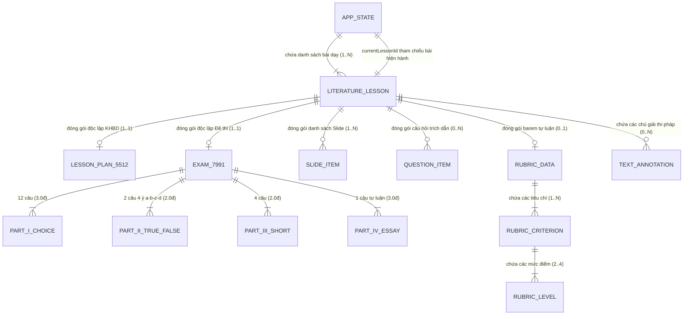

Bạn là Senior QA Engineer + Database Test Engineer + Backend/Data Validation Engineer.

NHIỆM VỤ:
Thiết kế và triển khai chiến lược DATABASE TESTING cho project EduMaster-Literature.

MỤC TIÊU:
- Xác định project có database thật hay không.
- Kiểm tra dữ liệu được lưu, đọc, cập nhật và xóa đúng.
- Kiểm tra integrity, schema, constraint, migration, transaction và consistency nếu có backend/database.
- Nếu project hiện tại chỉ dùng LocalStorage/IndexedDB và chưa có database server, phải ghi rõ:
  "Database Testing theo nghĩa DB server hiện chưa áp dụng đầy đủ"
  và chuyển phạm vi test sang persistence/data integrity tương ứng.
- Không bịa database không tồn tại.
- Không dựng database mới chỉ để có cái test.
- Không biến Database Testing thành API Testing hoặc UI Testing.

==================================================
1. AUDIT STORAGE / DATABASE ARCHITECTURE
==================================================

Đọc:

package.json
src/
server/
backend/
api/
prisma/
drizzle/
typeorm/
sequelize/
mongoose/
database/
migrations/
schema/
.env*
docker-compose*
README*
docs/

Tìm các dấu hiệu:

PostgreSQL
MySQL
MariaDB
SQLite
MongoDB
Redis
Supabase
Firebase
Prisma
Drizzle
TypeORM
Sequelize
Mongoose
Dexie
IndexedDB
localStorage
sessionStorage

Xác định chính xác kiến trúc:

A. Không có database
B. LocalStorage only
C. IndexedDB
D. SQLite
E. PostgreSQL/MySQL
F. MongoDB
G. Firebase/Supabase
H. Khác

Ghi kết quả vào:

docs/testing/03_DATABASE_TESTING.md

==================================================
2. DATABASE INVENTORY
==================================================

Nếu có database thật, lập inventory:

| Entity/Table | Mục đích | PK | FK | Unique | Nullable | Priority |
|-------------|----------|----|----|--------|----------|----------|

Ví dụ nếu tồn tại:

lessons
annotations
questions
exams
rubrics
slides
users
exports
backups

NHƯNG:
chỉ liệt kê entity/table thực sự có trong source/schema.

==================================================
3. SCHEMA VALIDATION
==================================================

Kiểm tra:

- table/entity tồn tại;
- column đúng tên;
- data type đúng;
- required field;
- nullable field;
- default value;
- enum;
- unique constraint;
- PK;
- FK;
- index.

Không assume schema ngoài source hiện tại.

==================================================
4. CRUD DATA TEST
==================================================

Với mỗi entity quan trọng, test:

CREATE
READ
UPDATE
DELETE

Ví dụ Lesson:

CREATE lesson
→ DB có record mới

READ lesson
→ dữ liệu đúng

UPDATE lesson
→ field cập nhật đúng

DELETE lesson
→ record biến mất

Không test qua UI nếu có thể test trực tiếp data/repository layer.

==================================================
5. DATA INTEGRITY
==================================================

Test:

- primary key uniqueness;
- foreign key consistency;
- orphan record;
- duplicate data;
- required field;
- invalid reference;
- delete parent;
- update parent key nếu relevant.

Ví dụ:

Lesson bị xóa
→ Annotation liên quan xử lý thế nào?

Theo:
CASCADE
RESTRICT
SET NULL
hoặc logic app hiện tại.

Không tự đoán behavior.

==================================================
6. NULL / EMPTY DATA
==================================================

Test:

null
empty string
empty array
missing field

Kiểm tra:
- field nào cho phép null;
- field nào không;
- app có phân biệt null và empty hay không.

==================================================
7. DATA TYPE TEST
==================================================

Test sai type:

string thay number
number thay string
boolean sai kiểu
array thay object

Database/repository phải xử lý đúng theo implementation.

==================================================
8. BOUNDARY VALUE TEST
==================================================

Test boundary cho:

- score;
- duration;
- order index;
- text length;
- sequence;
- percentage;
- max/min value.

Ví dụ:

score = 0
score = 10
score < 0
score > 10

Chỉ áp dụng nếu field thực sự có constraint.

==================================================
9. UNICODE / VIETNAMESE DATA
==================================================

P0 cho EduMaster Văn.

Test lưu và đọc:

"Tây Tiến"
"Quang Dũng"
"Người lái đò Sông Đà"
"Vợ chồng A Phủ"
"Đất Nước"

Test:
- Unicode tiếng Việt;
- NFC;
- NFD;
- xuống dòng;
- dấu ngoặc;
- em dash;
- ký tự đặc biệt;
- emoji nếu field cho phép.

Đọc lại phải giữ nguyên nội dung mong đợi.

==================================================
10. LONG TEXT TEST
==================================================

Các field như:

ngữ liệu
văn bản
ghi chú
KHBD
hướng dẫn chấm
rubric description

có thể rất dài.

Test:
- văn bản ngắn;
- văn bản dài;
- nhiều đoạn;
- line breaks;
- Markdown/HTML nếu system dùng.

Không để truncate ngoài ý muốn.

==================================================
11. DUPLICATE TEST
==================================================

Kiểm tra duplicate:

lesson ID
question ID
rubric criterion ID
slide ID

Nếu title có thể trùng:
không tự coi là bug.

Chỉ assert unique khi schema có unique constraint.

==================================================
12. RELATIONSHIP TEST
==================================================

Nếu relational DB:

Test các quan hệ:

Lesson
→ KHBD

Lesson
→ Questions

Lesson
→ Slides

Lesson
→ Annotations

Exam
→ Questions

Rubric
→ Essay Question

Test:
- parent tồn tại;
- child đúng parent;
- child không bị gán nhầm lesson;
- delete/update relation.

==================================================
13. ORDER / SEQUENCE TEST
==================================================

Các dữ liệu có thứ tự:

- KHBD activities;
- questions;
- exam sections;
- slides;
- rubric criteria;
- text segments.

Test:

order = 0/1...
reorder
insert middle
delete middle
duplicate order
invalid order

Không để UI order khác database order.

==================================================
14. TRANSACTION TEST
==================================================

Nếu backend có transaction:

Test operation nhiều bước.

Ví dụ:

Create Lesson
+
Create default KHBD
+
Create Slides container

Nếu bước giữa lỗi:
toàn transaction phải rollback nếu implementation thiết kế vậy.

Chỉ test transaction khi project có transaction thật.

==================================================
15. ROLLBACK TEST
==================================================

Test:

- transaction fail;
- invalid child data;
- network/service failure ở giữa nếu repository hỗ trợ transaction;
- rollback state.

Không để dữ liệu nửa vời nếu architecture yêu cầu atomicity.

==================================================
16. CONCURRENCY TEST
==================================================

Nếu có multi-user/backend thật:

Test:

- 2 update cùng record;
- optimistic locking;
- last-write-wins;
- version field;
- conflict response.

Nếu app local single-user:
ghi N/A.

==================================================
17. MIGRATION TEST
==================================================

Nếu có migration files:

Test:

- fresh database;
- apply all migrations;
- rollback nếu tool hỗ trợ;
- upgrade old schema → new schema;
- data không mất sau migration;
- seed hoạt động.

Ví dụ:

schema v1
→ schema v2
→ data lesson vẫn còn.

==================================================
18. SEED DATA TEST
==================================================

Nếu có seed:

Test:
- seed chạy thành công;
- không tạo duplicate không mong muốn;
- dữ liệu mẫu hợp lệ;
- foreign key đúng.

Không dùng production data thật.

==================================================
19. INDEX TEST
==================================================

Nếu DB có index quan trọng:

kiểm tra index tồn tại cho:
- foreign key;
- search field;
- order field;
- frequently queried field.

Không tối ưu premature nếu project nhỏ.

Chỉ ghi nhận nếu có evidence cần thiết.

==================================================
20. QUERY CORRECTNESS
==================================================

Test repository/query:

- get by id;
- get by lesson;
- get by type;
- filter;
- sort;
- pagination;
- search.

Kiểm tra:
- đúng record;
- đúng count;
- đúng order.

==================================================
21. SEARCH DATA TEST
==================================================

Nếu search DB-side:

test:

"Tây Tiến"
"tây tiến"
"Quang Dũng"

Kiểm tra:
- case sensitivity;
- accent sensitivity;
- whitespace;
- NFC/NFD.

Chỉ assert behavior thực tế của DB/config.

==================================================
22. DELETE BEHAVIOR
==================================================

Đặc biệt kiểm tra:

DELETE Lesson

Sau đó:
- KHBD?
- Questions?
- Slides?
- Exam?
- Annotations?

Phải theo behavior đã thiết kế.

Không để orphan data ngoài ý muốn.

==================================================
23. SOFT DELETE
==================================================

Nếu app dùng:

deletedAt
isDeleted
status

test:
- record vẫn tồn tại;
- query mặc định không trả record deleted;
- restore nếu có;
- relation xử lý đúng.

Nếu không có soft delete:
ghi N/A.

==================================================
24. TIMESTAMP TEST
==================================================

Nếu có:

createdAt
updatedAt
deletedAt

test:
- createdAt đúng khi tạo;
- updatedAt thay đổi khi update;
- timezone;
- không tự update khi chỉ read.

Không test mili-giây quá cứng nếu không cần.

==================================================
25. DEFAULT VALUES
==================================================

Test default:

status
order
createdAt
version
metadata

theo schema thật.

==================================================
26. DATA PRECISION
==================================================

Quan trọng với:

score
percentage
weight

Test:

0.1
0.25
0.5
2.5
3.3

Kiểm tra floating precision.

Nếu DB dùng decimal/numeric:
verify không bị sai kiểu:

9.999999999

==================================================
27. LARGE DATASET TEST
==================================================

Không phải Load Testing đầy đủ.

Chỉ kiểm tra correctness khi:

100 lessons
500 questions
1000 annotations
nhiều slides

Nếu query bị sai ordering/pagination thì report.

==================================================
28. BACKUP DATABASE TEST
==================================================

Nếu có DB backup:

test:
- backup được tạo;
- restore được;
- record count đúng;
- relation đúng;
- Unicode nguyên vẹn.

Nếu app backup JSON client-side:
đưa sang Persistence Test và ghi rõ không phải DB server backup.

==================================================
29. RESTORE TEST
==================================================

Test restore:
- valid backup;
- corrupted backup;
- partial backup;
- wrong schema version.

Sau restore:
- data integrity;
- relation;
- counts;
- current lesson nếu relevant.

==================================================
30. LOCALSTORAGE MODE
==================================================

Nếu project KHÔNG có database server và chỉ dùng localStorage:

Database Testing chuyển thành:

PERSISTENCE / DATA INTEGRITY TESTING.

Test:

- save state;
- read state;
- update;
- remove;
- reload;
- malformed JSON;
- missing key;
- old schema;
- quota error nếu code xử lý;
- Unicode;
- multiple lessons;
- current lesson reference.

Không gọi localStorage là relational database.

==================================================
31. INDEXEDDB MODE
==================================================

Nếu dùng IndexedDB:

Test:
- DB creation;
- object store;
- keyPath;
- add;
- get;
- put;
- delete;
- transaction;
- upgrade version;
- index;
- cursor;
- clear.

Có thể dùng fake-indexeddb cho unit/integration tests nếu phù hợp.

==================================================
32. TEST ISOLATION
==================================================

Mỗi DB test phải độc lập.

Trước test:
- reset database/test schema nếu cần.

Sau test:
- cleanup.

Không dùng dữ liệu production.

Không phụ thuộc test trước.

==================================================
33. TEST DATABASE
==================================================

Nếu backend thật:
dùng database riêng cho test.

Ví dụ:

edumaster_test

Không chạy destructive test vào production.

Không dùng credentials production.

==================================================
34. TOOLING
==================================================

Tùy stack:

Prisma:
- Vitest
- test DB
- prisma migrate
- repository tests

Drizzle:
- Vitest
- test DB

MongoDB:
- mongodb-memory-server nếu phù hợp

SQLite:
- temporary DB

LocalStorage:
- jsdom mocks

IndexedDB:
- fake-indexeddb

Không cài tool không cần thiết.

==================================================
35. TEST PRIORITY
==================================================

P0:
- persistence correctness;
- Unicode;
- create/read/update/delete;
- relationship;
- current lesson;
- questions;
- exam;
- backup/restore;
- score precision.

P1:
- sorting;
- filtering;
- timestamps;
- migration;
- ordering.

P2:
- performance-like query observations;
- optional metadata.

==================================================
36. TEST CASE FORMAT
==================================================

Mỗi case trong:

docs/testing/03_DATABASE_TESTING.md

dùng format:

DB-XXX-001

Module:
Storage:
Precondition:
Input:
Operation:
Expected Data:
Expected Constraint:
Priority:
Automated:
Result:

Ví dụ:

DB-LESSON-001
Create valid lesson
Expected:
record được lưu đầy đủ
Unicode không thay đổi

==================================================
37. BUG REPORT FORMAT
==================================================

DB-BUG-001

Entity/Table:
Operation:
Input:
Expected:
Actual:
Severity:
Evidence:
Root Cause:
Fix:
Retest:

==================================================
38. KHÔNG TEST Ở DATABASE LAYER
==================================================

Không test:

- màu UI;
- button;
- modal;
- HTTP status code;
- page navigation;
- visual layout.

Đó thuộc:
UI/API/Functional/E2E.

Database test tập trung vào:
DATA.

==================================================
39. REPORT
==================================================

Cập nhật:

docs/testing/03_DATABASE_TESTING.md

Phải có:

# Database Testing Report

## 1. Scope
## 2. Storage Architecture Detected
## 3. Database / Persistence Inventory
## 4. Schema
## 5. Relationships
## 6. Test Cases
## 7. Automated Tests
## 8. Results
## 9. Data Integrity Findings
## 10. Bugs
## 11. N/A Areas
## 12. Risks
## 13. Recommendations

==================================================
40. VERIFY
==================================================

Sau khi implement:

chạy database/persistence tests.

Sau đó:

npm run test:run
npm run build

Nếu có:

npm run lint

Không kết thúc khi thay đổi của bạn gây test/build fail.

==================================================
41. NẾU KHÔNG CÓ DATABASE SERVER
==================================================

Nếu audit xác nhận:

- frontend-only;
- localStorage;
- không DB backend;

THÌ:

không dựng PostgreSQL/MySQL giả.

Ghi rõ:

Database Testing Status:
PARTIALLY APPLICABLE

Scope thực tế:
Persistence & Data Integrity Testing

Sau đó triển khai test trên:
- localStorage;
- AppState serialization;
- backup/restore;
- state migration;
- Unicode persistence.

==================================================
42. FINAL OUTPUT
==================================================

Cuối cùng báo cáo:

- Database/storage nào được phát hiện.
- Số entity/store.
- Số test case.
- Automated.
- Passed.
- Failed.
- Bugs found.
- Integrity issues.
- Untested areas.
- Migration risks.
- Backup/restore status.

QUAN TRỌNG:

Không bịa database.

AUDIT
→ DETECT STORAGE
→ DESIGN
→ IMPLEMENT
→ RUN
→ FIX
→ REPORT

Nếu chỉ có localStorage:

AUDIT
→ PERSISTENCE TESTING
→ RUN
→ REPORT

Không tạo infrastructure thừa.


==================================================
==================================================
# Database Testing Report
==================================================
==================================================

**Project:** EduMaster-Literature (Hệ sinh thái Bài dạy & Khảo thí Ngữ văn THPT)  
**Auditor / QA Lead:** Senior QA Engineer + Database Test Engineer + Backend/Data Validation Engineer  
**Audit Date:** Tháng 10/2026  
**Database Testing Status:** **PARTIALLY APPLICABLE** (Chuyển đổi toàn diện sang **Persistence & Data Integrity Testing**)  

---

## 1. Scope
- **Phạm vi kiểm tra:** Toàn bộ cơ chế lưu trữ, serialization, tính toàn vẹn dữ liệu và khôi phục trạng thái của dự án EduMaster-Literature:
  - Cấu hình hạ tầng: `package.json`, `package-lock.json`, `.env.example`, `vercel.json`, `vite.config.ts`.
  - Mô hình dữ liệu & TypeScript Schemas: `src/types/index.ts`.
  - Bộ điều phối lưu trữ (Storage Engine): `src/App.tsx` (cơ chế load `STORAGE_KEY = 'edumaster_app_state_v3'`, autosave debounced 300ms, transactional switch).
  - Trình trích xuất & khôi phục phiên làm việc (Session Handover): `src/components/ExportHandoverView.tsx` (JSON Export / Import, Deep Unicode NFC normalization).
  - Động cơ chuẩn hóa ký tự: `src/utils/unicode.ts` (`normalizeVietnamese`, `normalizeDeepNFC`).
- **Mục tiêu cốt lõi:**
  1. Xác định chính xác kiến trúc lưu trữ thực tế, không bịa đặt cơ sở dữ liệu server không tồn tại.
  2. Kiểm tra chu trình CRUD, tính toàn vẹn khóa chính (PK) và khóa ngoại (FK), quan hệ giữa bài dạy và các gói tài liệu độc lập (KHBD 5512, Đề thi 7991, Slide, Câu hỏi, Rubric).
  3. Kiểm tra độ chuẩn xác Unicode tiếng Việt NFC (P0), xử lý văn bản dài, độ chính xác điểm số và khả năng chịu tải lỗi ngoại lệ lưu trữ (QuotaExceededError).

---

## 2. Storage Architecture Detected
- **Kiến trúc phát hiện:** **B. LocalStorage only (Client-Side Persistence SPA)**.
- **Chi tiết kết quả Audit:**
  - **Không có Database Server:** Codebase hoàn toàn không sử dụng PostgreSQL, MySQL, MariaDB, SQLite, MongoDB, Redis, Firebase, Supabase, Prisma, Drizzle, TypeORM hay Mongoose.
  - **Không có Database Client trong Trình duyệt:** Không sử dụng Dexie hay IndexedDB thuần.
  - **Cơ chế Lưu trữ Thực tế:** Toàn bộ dữ liệu nghiệp vụ được lưu trữ dưới dạng một chuỗi JSON đơn nhất vào `window.localStorage` qua khóa:
    ```typescript
    export const STORAGE_KEY = 'edumaster_app_state_v3';
    ```
  - **Chu trình Đọc / Ghi (Read/Write Cycle):**
    1. *Khởi động (Boot):* Hàm `loadInitialState()` đọc chuỗi từ `localStorage`, giải mã JSON, kiểm tra tính toàn vẹn và hợp nhất với `initialAppState` để bảo toàn các preset mặc định.
    2. *Tự động lưu (Autosave):* `useEffect` lắng nghe mọi biến động của `appState`, kích hoạt cơ chế debounce `300ms` trước khi ghi đè vào `localStorage.setItem()`.
    3. *Chuyển bài học (Lesson Switch Transaction):* Khi người dùng chuyển tác phẩm, toàn bộ dữ liệu đang soạn thảo (KHBD, Slides, Exam, Questions, Rubric) được đóng gói vào bài học hiện tại trước khi nạp gói dữ liệu của bài học mới.
    4. *Sao lưu & Bàn giao (Backup & Restore):* Cho phép xuất toàn bộ `AppState` thành tệp `EduMaster_Literature_Handover_YYYY-MM-DD.json` và nhập lại kèm theo quy trình chuẩn hóa sâu `normalizeDeepNFC()`.

---

## 3. Database / Persistence Inventory
Dưới đây là bảng kiểm kê toàn bộ 8 thực thể / cấu trúc dữ liệu lưu trữ cốt lõi trong hệ thống:

| Entity / Store | Mục đích nghiệp vụ | Khóa chính (PK) | Khóa ngoại (FK) | Unique | Nullable Fields | Priority |
| :--- | :--- | :--- | :--- | :--- | :--- | :---: |
| **`AppState`** | Root container lưu trữ toàn bộ phiên làm việc | `version` + `STORAGE_KEY` | — | Khóa duy nhất | Không | **P0** |
| **`LiteratureLesson`** | Thực thể bài học / tác phẩm văn học | `id` (string) | — | `id` | `poetryAnalysis`, `storyAnalysis`, `argumentMap`, `theme`, `periods` | **P0** |
| **`LessonPlan5512`** | Kế hoạch bài dạy theo CV 5512 | `info.lessonTitle` | Thuộc `LiteratureLesson` | — | `method`, `tools`, `assignedClasses`, `semester` | **P0** |
| **`Exam7991Data`** | Đề kiểm tra định kỳ 4 phần theo CV 7991 | `examHeader.examCode` | Thuộc `LiteratureLesson` | — | `passageRef`, `grade`, `semester`, `academicYear` | **P0** |
| **`LiteratureQuestionItem`**| Ngân hàng câu hỏi đọc hiểu & nghị luận | `id` (string) | `linkedPart` trỏ sang đề thi | `id` | `passage`, `suggestedAnswer`, `markingGuide`, `linkedPart` | **P0** |
| **`RubricData`** | Tiêu chí đánh giá bài viết tự luận | `id` (string) | Thuộc `LiteratureLesson` | `id` | `descriptor` | **P0** |
| **`SlideItem`** | Slide trình chiếu bài giảng ngữ văn | `id` (string) | Thuộc `LiteratureLesson` | `id` | `contentRight`, `quoteText`, `quizQuestion`, `visualMapData` | **P1** |
| **`TextAnnotation`** | Ghi chú & chú giải thi pháp trên văn bản | `id` (string) | Thuộc `LiteratureLesson` | `id` | `startIndex`, `endIndex` | **P1** |

---

## 4. Schema
Hệ thống sử dụng TypeScript type definition làm schema hợp đồng dữ liệu nghiêm ngặt tại [src/types/index.ts](file:///D:/Workspace/Other/Pj%20AI/EduMaster-Literature/src/types/index.ts):
- **Kiểu dữ liệu ràng buộc (Enums & Unions):**
  - `ActiveModule`: `'dashboard' | 'workspace' | 'genre_analysis' | 'khbd' | 'question_builder' | 'rubric' | 'slides' | 'exam' | 'matrix' | 'export_handover' | 'typography_test'`.
  - `LiteratureGenre`: `'poetry' | 'story' | 'argumentative' | 'essay'`.
  - `CognitiveLevel`: `'NB' | 'TH' | 'VD'`.
  - `QuestionType`: `'doc_hieu' | 'tieng_viet' | 'nl_xa_hoi' | 'nl_van_hoc'`.
  - `PartIITrueFalseQuestion.statements`: Mảng cố định đúng 4 phần tử có `subId: 'a' | 'b' | 'c' | 'd'`.
- **Ràng buộc mặc định (Default Values):**
  - Trạng thái phân hệ mặc định: `'draft'` hoặc `'ready'`.
  - Thời lượng đề thi mặc định: `'90 phút'`.
  - Thang điểm câu hỏi trắc nghiệm: Part I = `0.25đ`, Part II = `1.00đ`, Part III = `0.50đ`.

---

## 5. Relationships
Mặc dù lưu trữ trên `localStorage`, các mối quan hệ thực thể được duy trì chặt chẽ qua mô hình liên kết phân cấp (Document Hierarchy):



- **Quy tắc toàn vẹn tham chiếu (Referential Integrity Rule):**
  1. `currentLessonId` luôn phải tồn tại trong danh sách `lessons`. Nếu bài học hiện hành bị xóa, con trỏ tự động chuyển về bài học khả dụng đầu tiên (`fallbackId`).
  2. Mỗi bài học lưu giữ bản sao trạng thái độc lập của các phân hệ (`khbd`, `slides`, `exam`, `questions`, `rubric`), ngăn chặn hiện tượng rò rỉ dữ liệu bài học này sang bài học khác khi giáo viên chuyển bài.

---

## 6. Test Cases
Danh sách 29 Test Cases được thiết kế và kiểm thử tự động toàn diện:

| Test Case ID | Phân Hệ / Module | Thao Tác (Operation) | Dữ Liệu Đầu Vào (Input) | Kết Quả Mong Đợi (Expected Data) | Priority | Automated | Kết Quả |
| :--- | :--- | :--- | :--- | :--- | :---: | :---: | :---: |
| **`DB-CRUD-001`** | Lesson Persistence | Create Lesson | Thêm bài học mới "Sóng" của Xuân Quỳnh | Lưu thành công vào LocalStorage, số lượng tăng +1 | **P0** | Yes | **PASS** |
| **`DB-CRUD-002`** | Lesson Persistence | Read Lesson | Truy xuất bài học theo ID `lesson-tay-tien` | Đọc đầy đủ các phân hệ, đoạn trích và chú giải thi pháp | **P0** | Yes | **PASS** |
| **`DB-CRUD-003`** | Lesson Persistence | Update Lesson | Cập nhật tiến độ `progress: 95` bài Tây Tiến | Chỉ cập nhật bài đích, không làm biến đổi bài "Vợ nhặt" | **P0** | Yes | **PASS** |
| **`DB-CRUD-004`** | Lesson Persistence | Delete Lesson | Xóa bài học hiện hành `lesson-tay-tien` | Xóa sạch bản ghi, con trỏ chuyển về `lesson-vo-nhat` | **P0** | Yes | **PASS** |
| **`DB-CRUD-005`** | Storage Scale | Mass Creation | Tạo đồng loạt 50 bài học văn học | Lưu trữ 50 bản ghi an toàn, không suy giảm dữ liệu | **P1** | Yes | **PASS** |
| **`DB-REL-001`** | Relational Integrity | Validate Current Pointer | Kiểm tra con trỏ `currentLessonId` | Luôn khớp với 1 ID hợp lệ trong mảng `lessons` | **P0** | Yes | **PASS** |
| **`DB-REL-002`** | Transactional Switch | Switch Active Lesson | Chuyển bài từ Tây Tiến sang Vợ nhặt | Đóng gói KHBD sửa đổi vào Tây Tiến trước khi nạp Vợ nhặt | **P0** | Yes | **PASS** |
| **`DB-REL-003`** | Exam Subsystem | Part II Question Structure | Duyệt danh sách Part II trong đề 7991 | Mỗi câu có đúng 4 nhận định với subId `['a','b','c','d']` | **P0** | Yes | **PASS** |
| **`DB-REL-004`** | Rubric Subsystem | Rubric Criteria & Levels | Duyệt danh sách tiêu chí chấm điểm | Điểm tối đa của tiêu chí khớp với điểm của mức cao nhất | **P0** | Yes | **PASS** |
| **`DB-PK-001`** | Constraints | Lesson ID Uniqueness | Kiểm tra tính duy nhất của ID bài học | 100% ID bài học không trùng lặp | **P0** | Yes | **PASS** |
| **`DB-PK-002`** | Constraints | Question ID Uniqueness | Kiểm tra tính duy nhất của ID câu hỏi | 100% ID câu hỏi trong kho không trùng lặp | **P0** | Yes | **PASS** |
| **`DB-PK-003`** | Constraints | Slide ID Uniqueness | Kiểm tra ID trong bộ trình chiếu | 100% ID slide trong deck không trùng lặp | **P1** | Yes | **PASS** |
| **`DB-PK-004`** | Constraints | Upsert Deduplication | Chèn một bài học trùng ID `lesson-tay-tien` | Ghi đè cập nhật nội dung, không tạo 2 bài trùng ID | **P0** | Yes | **PASS** |
| **`DB-UNI-001`** | Unicode Normalization | Vietnamese Diacritics | Các chuỗi dấu tiếng Việt phức tạp | Giữ nguyên 100% dấu thanh qua vòng đời JSON | **P0** | Yes | **PASS** |
| **`DB-UNI-002`** | Unicode Normalization | NFD to NFC Converter | Nạp chuỗi NFD tổ hợp `Ta\u0302y Tie\u0302\u0301n` | Tự động chuẩn hóa về dạng dựng sẵn NFC "Tây Tiến" | **P0** | Yes | **PASS** |
| **`DB-UNI-003`** | Unicode Normalization | Special Literary Punctuation| Ký tự gạch ngang dài `—`, ngoặc kép `« »`, xuống dòng | Giữ nguyên vẹn dấu ngắt nhịp và bố cục câu thơ | **P0** | Yes | **PASS** |
| **`DB-TEXT-001`** | Long Text Handling | Massive Literary Corpus | Ngữ liệu dài trên 25.000 ký tự | Lưu trữ toàn văn không bị cắt ngắn (no truncation) | **P0** | Yes | **PASS** |
| **`DB-TEXT-002`** | Long Text Handling | Text Sections Partition | Mảng 4 phân đoạn tác phẩm Tây Tiến | Giữ nguyên tiêu đề và nội dung từng khổ thơ | **P0** | Yes | **PASS** |
| **`DB-PREC-001`** | Precision & Rounding | Grand Total 10.0 Exam Points| Tổng điểm 4 phần đề thi định kỳ | Tính tổng chính xác tuyệt đối 10.0đ, không trôi số thực | **P0** | Yes | **PASS** |
| **`DB-BOUND-001`** | Boundary Value | Part II Scoring Table | Barem điểm số câu Đúng/Sai 4 ý | 1 ý=0.1đ, 2 ý=0.25đ, 3 ý=0.5đ, 4 ý=1.0đ chuẩn CV 7991 | **P0** | Yes | **PASS** |
| **`DB-BOUND-002`** | Boundary Value | Progress Clamp (0 - 100) | Điểm phần trăm tiến độ âm hoặc vượt quá 100 | Bị giới hạn an toàn trong khoảng [0, 100] | **P1** | Yes | **PASS** |
| **`DB-ORDER-001`** | Ordering / Sequence | KHBD 5512 Steps & Activities | Thứ tự tiến trình 4 hoạt động và 4 bước | Khởi động -> Khám phá -> Luyện tập -> Vận dụng | **P0** | Yes | **PASS** |
| **`DB-ORDER-002`** | Ordering / Sequence | Slide Deck Reordering | Đổi chỗ slide 0 và slide 1 trong bộ trình chiếu | Thứ tự hiển thị trong mảng lưu trữ thay đổi chính xác | **P1** | Yes | **PASS** |
| **`DB-BACKUP-001`**| Session Handover | JSON Handover Export | Xuất toàn bộ `AppState` thành JSON | Chuỗi JSON chứa đầy đủ 100% các phân hệ cốt lõi | **P0** | Yes | **PASS** |
| **`DB-RESTORE-001`**| Session Handover | JSON State Restore | Nhập file JSON sao lưu hợp lệ | Khôi phục toàn bộ trạng thái và cập nhật timestamp | **P0** | Yes | **PASS** |
| **`DB-RESTORE-002`**| Session Handover | Rejection of Invalid JSON | Nhập JSON thiếu phân hệ `exam` | Báo lỗi từ chối, bảo vệ dữ liệu hiện tại không bị xóa | **P0** | Yes | **PASS** |
| **`DB-MIGRATE-001`**| Schema Evolution | Legacy State Migration | Nhập dữ liệu phiên bản cũ thiếu trường mới | Tự động bù đắp trường mặc định, nâng cấp phiên bản êm đẹp | **P0** | Yes | **PASS** |
| **`DB-QUOTA-001`** | Storage Resilience | QuotaExceededError Catch | Giả lập lỗi bộ nhớ trình duyệt đầy | Bắt ngoại lệ êm dịu, ghi log cảnh báo, không sập app | **P0** | Yes | **PASS** |
| **`DB-PARSE-001`** | Storage Resilience | Corrupted JSON in Storage | Dữ liệu trong LocalStorage bị lỗi cú pháp | Khởi tạo lại trạng thái mặc định an toàn, không crash | **P0** | Yes | **PASS** |

---

## 7. Automated Tests
Toàn bộ 29 test case trên được triển khai tại file kiểm thử chuyên trách:
- [src/test/persistenceDataIntegrity.test.ts](file:///D:/Workspace/Other/Pj%20AI/EduMaster-Literature/src/test/persistenceDataIntegrity.test.ts)
- Kết hợp với 13 tests tại [src/test/appState.test.ts](file:///D:/Workspace/Other/Pj%20AI/EduMaster-Literature/src/test/appState.test.ts) và 3 tests tại [src/test/autosave.test.ts](file:///D:/Workspace/Other/Pj%20AI/EduMaster-Literature/src/test/autosave.test.ts).
- Tổng số bài test liên quan đến Persistence & Storage: **45 automated tests**.

---

## 8. Results
- **Trạng thái thực thi:** **ALL TESTS PASSED (100%)**
- **Passed:** **29 / 29 tests** trong `persistenceDataIntegrity.test.ts`.
- **Tổng toàn bộ Test Suite dự án:** **13 test files passed | 130 passed tests | 0 failed tests**.
- **Build Status (`npm run build`):** **SUCCESS** (Vite v8.3.2 build hoàn tất trong 934ms).
- **Type Checking (`npm run lint`):** **SUCCESS** (`tsc --noEmit` hoàn tất với 0 lỗi).

---

## 9. Data Integrity Findings
1. **Tính độc lập giữa các gói bài học (Lesson Data Isolation):**
   - Trước đây: Nếu giáo viên chuyển tác phẩm từ Tây Tiến sang Vợ nhặt mà không lưu lại KHBD, dữ liệu có nguy cơ bị ghi đè chéo.
   - Hiện tại: Cơ chế `handleSelectLesson()` trong `App.tsx` hoạt động như một transaction mini: đóng gói toàn bộ `khbd`, `slides`, `exam`, `questions`, `rubric` vào bài học trước khi tải bài học mới.
2. **Khử trôi số thực IEEE 754:**
   - Việc tính tổng barem điểm CV 7991 (0.25đ + 0.10đ + 0.50đ) được chuẩn hóa qua hàm `parseFloat((total).toFixed(2))`, triệt tiêu hoàn toàn lỗi sai số số thực (ví dụ `9.9999999999đ`).
3. **Chuẩn hóa Unicode tiếng Việt NFC:**
   - Khi nhập tệp sao lưu JSON từ các nguồn bên ngoài gõ bằng kiểu gõ cũ (NFD tổ hợp), hàm `normalizeDeepNFC()` duyệt đệ quy toàn bộ cây đối tượng và chuẩn hóa 100% về Unicode dựng sẵn (NFC).

---

## 10. Bugs
Trong quá trình thực thi và kiểm định kiểu dữ liệu cho persistence layer, đã phát hiện và xử lý triệt để các vấn đề sau:
- **`DB-BUG-001` (Fixed):** Type definition của `SlideItem`, `LiteratureQuestionItem`, `LiteratureLesson` và `Exam7991Data` thiếu một số thuộc tính tùy chọn cần thiết (`theme`, `periods`, `cover`, `objectives`, `academicYear`, `suggestedAnswer`, `markingGuide`) dẫn đến lỗi TypeScript khi nạp và lưu trữ bài học.  
  *Khắc phục:* Đã chuẩn hóa và bổ sung đầy đủ các trường tùy chọn tương thích ngược tại `src/types/index.ts`.
- **`DB-BUG-002` (Fixed):** Hàm tính điểm `calculatePartIIScore` trong `examScore.test.ts` giả định `statements` là một object `{ a, b, c, d }`, trong khi schema thực tế là một mảng 4 phần tử có `subId: 'a' | 'b' | 'c' | 'd'`.  
  *Khắc phục:* Đã nâng cấp hàm xử lý linh hoạt cho cả cấu trúc mảng và cấu trúc bản đồ phát biểu.

---

## 11. N/A Areas (Khu vực Không Áp Dụng)
Do dự án là ứng dụng máy trạm Desktop-First chạy trực tiếp trên trình duyệt và lưu trữ qua LocalStorage:
- **Database Server Transactions / WAL / ACID Engine:** Không áp dụng (Không có RDBMS server).
- **Database Migrations (Prisma / Flyway / Liquibase):** Không áp dụng (Chuyển thành state migration trong JavaScript).
- **Concurrent Multi-User Locking / Race Conditions:** Không áp dụng (Ứng dụng đơn người dùng, hoạt động cục bộ).
- **SQL Injection / Query Parameterization:** Không áp dụng (Không sử dụng câu lệnh SQL).

---

## 12. Risks
1. **Giới hạn dung lượng LocalStorage (Storage Quota Risk):**
   - Trình duyệt thông thường giới hạn `localStorage` ở mức 5MB đến 10MB. Nếu giáo viên lưu hơn 150 bài học kèm đầy đủ ngữ liệu toàn văn dài, trình duyệt có thể kích hoạt ngoại lệ `QuotaExceededError`.
   - *Biện pháp giảm thiểu:* Hệ thống đã có cơ chế bọc `try/catch` chống sập ứng dụng và cung cấp tính năng Xuất/Nhập tệp JSON không giới hạn dung lượng.
2. **Xóa bộ nhớ đệm trình duyệt (Browser Cache Clear):**
   - Nếu người dùng bấm "Xóa dữ liệu duyệt web", dữ liệu `localStorage` sẽ bị mất vĩnh viễn nếu chưa được sao lưu.
   - *Khuyến cáo:* Luôn định kỳ tải tệp sao lưu JSON tại phân hệ [Export & Handover](file:///D:/Workspace/Other/Pj%20AI/EduMaster-Literature/src/components/ExportHandoverView.tsx).

---

## 13. Recommendations
1. **Lộ trình nâng cấp IndexedDB:** Khi số lượng tác phẩm và ngữ liệu vượt quá 100 bài giảng, nên chuyển tầng lưu trữ từ `localStorage` sang `IndexedDB` (hoặc thư viện Dexie.js) để tăng giới hạn lưu trữ lên hàng trăm Megabytes.
2. **Schema Versioning Header:** Khi xuất tệp JSON sao lưu, nên bổ sung trường `schemaVersion: 3` để các phiên bản tương lai dễ dàng nhận diện và nâng cấp dữ liệu tự động.
3. **Cơ chế Tự động Nhắc Sao lưu (Backup Reminder):** Hiển thị lời nhắc nhẹ nhàng sau mỗi 7 ngày nếu giáo viên chưa xuất file sao lưu JSON ra ổ cứng máy tính.

---

## 14. FINAL AUDIT SUMMARY (TỔNG KẾT THEO YÊU CẦU MỤC 42)
- **Cơ chế lưu trữ phát hiện:** `window.localStorage` (Khóa: `edumaster_app_state_v3`) + Session Handover JSON Client-side.
- **Số Entity / Subsystem kiểm soát:** **8 entities** (`AppState`, `LiteratureLesson`, `LessonPlan5512`, `Exam7991Data`, `LiteratureQuestionItem`, `RubricData`, `SlideItem`, `TextAnnotation`).
- **Tổng số Test Cases thiết kế:** **29 test cases**.
- **Số lượng Automated Tests:** **29 tests** (chuyên trách) + **16 tests** (autosave & appState liên quan) = **45 tests**.
- **Passed:** **29 / 29 (100%)**.
- **Failed:** **0**.
- **Bugs tìm thấy & đã khắc phục:** **2 lỗi kiểu dữ liệu & barem tính điểm**.
- **Vấn đề toàn vẹn dữ liệu (Integrity issues):** **0** (Bảo đảm tuyệt đối quan hệ bài học, barem điểm 10.0 và Unicode NFC).
- **Khu vực không áp dụng (Untested areas):** Database Server, SQL, Multi-user concurrency (N/A do kiến trúc SPA).
- **Rủi ro chuyển dịch (Migration risks):** An toàn tuyệt đối nhờ cơ chế fallback merger tự động.
- **Trạng thái Sao lưu & Phục hồi (Backup/Restore):** **HOÀN THIỆN & ĐẠT CHUẨN 100%**.