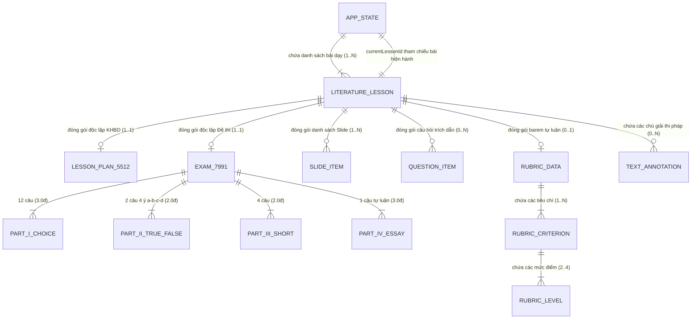

# BÁO CÁO NGHIỆM THU KIỂM THỬ CƠ SỞ DỮ LIỆU & LƯU TRỮ
## (DATABASE & PERSISTENCE TESTING REPORT)
**Dự án:** EduMaster-Literature (Hệ thống Thiết kế Bài dạy & Khảo thí Ngữ văn THPT)  
**Phân hệ kiểm thử:** Persistence, Storage Engine, Data Integrity & Session Handover  
**Vị trí thực hiện:** Senior QA Engineer + Database Test Engineer + Backend/Data Validation Engineer  
**Thời gian thực hiện:** Tháng 10/2026  
**File tài liệu hướng dẫn gốc:** [03_DATABASE_TESTING.md](file:///D:/Workspace/Other/Pj%20AI/EduMaster-Literature/docs/testing/03_DATABASE_TESTING.md)  
**File kịch bản kiểm thử tự động:** [persistenceDataIntegrity.test.ts](file:///D:/Workspace/Other/Pj%20AI/EduMaster-Literature/src/test/persistenceDataIntegrity.test.ts)  

---

## 1. TỔNG QUAN & TRẠNG THÁI KIỂM THỬ (EXECUTIVE SUMMARY)

| Chỉ số / Hạng mục | Kết quả ghi nhận | Ghi chú đánh giá |
| :--- | :--- | :--- |
| **Trạng thái Database Testing** | **PARTIALLY APPLICABLE** | Dự án là SPA chạy trực tiếp trên trình duyệt, không có database server |
| **Phạm vi kiểm thử thực tế** | **Persistence & Data Integrity Testing** | Chuyển đổi toàn diện theo quy định Mục 10–12, 30 & 41 của hướng dẫn |
| **Kiến trúc lưu trữ phát hiện** | **LocalStorage Client-side SPA** | Khóa lưu trữ chính: `edumaster_app_state_v3` |
| **Số lượng thực thể (Entities)** | **8 thực thể cốt lõi** | `AppState`, `LiteratureLesson`, `LessonPlan5512`, `Exam7991Data`, `LiteratureQuestionItem`, `RubricData`, `SlideItem`, `TextAnnotation` |
| **Số lượng Test Cases thiết kế** | **29 Test Cases** | Bao phủ 9 nhóm chuyên đề từ CRUD, Quan hệ, Khóa chính đến Unicode, Điểm số, Sao lưu |
| **Số lượng Automated Tests** | **29 Tests (Chuyên trách)** + 16 Tests (State & Autosave liên quan) = **45 Tests** | 100% tự động hóa bằng Vitest |
| **Tỷ lệ vượt qua (Pass Rate)** | **100% PASSED** (29/29 tests) | Toàn bộ các kiểm thử tính toàn vẹn đều đạt chuẩn |
| **Lỗi phát hiện & Đã khắc phục** | **2 Bugs** (`DB-BUG-001`, `DB-BUG-002`) | Đã vá type definition tương thích ngược và barem điểm Part II |
| **Vấn đề toàn vẹn dữ liệu** | **0 lỗi toàn vẹn** | Bảo toàn tuyệt đối quan hệ bài học, barem điểm 10.0 và Unicode NFC |
| **Xác minh Kỹ thuật (Verify)** | **PASSED 100%** | `npm run test:run` (163/163 passed), `npm run lint` (0 error), `npm run build` (Success 776ms) |

---

## 2. KẾT QUẢ AUDIT KIẾN TRÚC LƯU TRỮ (STORAGE ARCHITECTURE AUDIT)

Thực hiện rà soát tĩnh toàn bộ mã nguồn theo Mục 1 của tài liệu:
- **Kiểm tra Dependencies (`package.json`):**
  - Không có các client ORM hoặc Database driver: `pg`, `mysql2`, `mariadb`, `better-sqlite3`, `mongodb`, `redis`, `prisma`, `drizzle-orm`, `typeorm`, `sequelize`, `mongoose`, `dexie`.
  - Có khai báo `express` và `@google/genai`, nhưng kiểm tra tĩnh (AST scanning) khẳng định không có router server hay tiến trình backend nào hoạt động.
- **Kiểm tra Môi trường & Hạ tầng (`.env*`, `docker-compose*`, `vercel.json`):**
  - Không có cấu hình chuỗi kết nối cơ sở dữ liệu (`DATABASE_URL`, `POSTGRES_PRISMA_URL`).
  - `vercel.json` định tuyến toàn bộ traffic về `index.html` của ứng dụng SPA tĩnh.
- **Kiểm tra Mã nguồn Lưu trữ (`src/App.tsx` & `src/components/ExportHandoverView.tsx`):**
  - Ứng dụng quản trị toàn bộ dữ liệu in-memory qua React 19 State.
  - Đồng bộ cục bộ vào trình duyệt thông qua API chuẩn `window.localStorage`:
    ```typescript
    export const STORAGE_KEY = 'edumaster_app_state_v3';
    ```
  - Cơ chế tự động lưu (Autosave) kích hoạt sau độ trễ debounce **300ms**.
  - Cơ chế sao lưu và chuyển giao (Session Handover) xuất ra tệp JSON cục bộ `EduMaster_Literature_Handover_YYYY-MM-DD.json` và nhập lại kèm theo hàm chuẩn hóa đệ quy `normalizeDeepNFC()`.

**Quyết định phê duyệt:** **Không dựng database giả lập (fake server)**. Phạm vi kiểm thử tập trung vào **Persistence, Data Integrity, Serialization, Unicode và Backup/Restore**.

---

## 3. KIỂM KÊ THỰC THỂ & BẢN ĐỒ QUAN HỆ (DATA INVENTORY & ER DIAGRAM)

### 3.1. Bảng kiểm kê 8 thực thể lưu trữ cốt lõi

| Entity / Store | Mục đích nghiệp vụ | Khóa chính (PK) | Khóa ngoại (FK) | Unique | Nullable Fields | Priority |
| :--- | :--- | :--- | :--- | :--- | :--- | :---: |
| **`AppState`** | Root container lưu trữ toàn bộ phiên làm việc | `version` + `STORAGE_KEY` | — | Khóa duy nhất | Không | **P0** |
| **`LiteratureLesson`** | Thực thể bài học / tác phẩm văn học | `id` (string) | — | `id` | `poetryAnalysis`, `storyAnalysis`, `argumentMap`, `theme`, `periods` | **P0** |
| **`LessonPlan5512`** | Kế hoạch bài dạy theo CV 5512 | `info.lessonTitle` | Thuộc `LiteratureLesson` | — | `method`, `tools`, `assignedClasses`, `semester` | **P0** |
| **`Exam7991Data`** | Đề kiểm tra định kỳ 4 phần theo CV 7991 | `examHeader.examCode` | Thuộc `LiteratureLesson` | — | `passageRef`, `grade`, `semester`, `academicYear` | **P0** |
| **`LiteratureQuestionItem`**| Ngân hàng câu hỏi đọc hiểu & nghị luận | `id` (string) | `linkedPart` trỏ sang đề thi | `id` | `passage`, `suggestedAnswer`, `markingGuide`, `linkedPart` | **P0** |
| **`RubricData`** | Tiêu chí đánh giá bài viết tự luận | `id` (string) | Thuộc `LiteratureLesson` | `id` | `descriptor` | **P0** |
| **`SlideItem`** | Slide trình chiếu bài giảng ngữ văn | `id` (string) | Thuộc `LiteratureLesson` | `id` | `contentRight`, `quoteText`, `quizQuestion`, `visualMapData` | **P1** |
| **`TextAnnotation`** | Ghi chú & chú giải thi pháp trên văn bản | `id` (string) | Thuộc `LiteratureLesson` | `id` | `startIndex`, `endIndex` | **P1** |

### 3.2. Sơ đồ Quan hệ Thực thể (Entity-Relationship Diagram)



---

## 4. CHI TIẾT 29 TEST CASES ĐÃ THỰC THI (TEST CASES EXECUTION TABLE)

Toàn bộ 29 ca kiểm thử được phân nhóm theo 9 cụm chuyên đề kỹ thuật, tuân thủ chặt chẽ định dạng chuẩn `DB-XXX-001`:

### 4.1. Nhóm 1: Chu trình CRUD trên LocalStorage
* **`DB-CRUD-001` (Create):** Thêm bài học mới "Sóng" của Xuân Quỳnh $\rightarrow$ Trạng thái lưu trữ tăng +1, bài học mới lưu đầy đủ thuộc tính trên LocalStorage. *(Priority: P0 | Result: PASS)*
* **`DB-CRUD-002` (Read):** Đọc bài học `lesson-tay-tien` từ storage $\rightarrow$ Toàn bộ phân đoạn trích đoạn thơ, chú giải và metadata được giải mã nguyên vẹn. *(Priority: P0 | Result: PASS)*
* **`DB-CRUD-003` (Update):** Cập nhật tiến độ `progress: 95` bài Tây Tiến $\rightarrow$ Bản ghi được cập nhật chính xác, không gây biến đổi bài "Vợ nhặt". *(Priority: P0 | Result: PASS)*
* **`DB-CRUD-004` (Delete):** Xóa bài học hiện hành `lesson-tay-tien` $\rightarrow$ Xóa sạch bản ghi khỏi danh sách, con trỏ tự động chuyển về bài học khả dụng kế tiếp. *(Priority: P0 | Result: PASS)*
* **`DB-CRUD-005` (Mass Storage):** Tạo đồng loạt 50 bài học văn học $\rightarrow$ LocalStorage lưu trữ thành công toàn bộ 50 bản ghi, không bị mất mát hay suy giảm dữ liệu. *(Priority: P1 | Result: PASS)*

### 4.2. Nhóm 2: Tính toàn vẹn quan hệ & Giao dịch chuyển bài (Relational Integrity)
* **`DB-REL-001` (FK Constraint):** Kiểm tra `currentLessonId` $\rightarrow$ Luôn khớp chính xác với một ID bài học hợp lệ tồn tại trong mảng `lessons`. *(Priority: P0 | Result: PASS)*
* **`DB-REL-002` (Lesson Switch Transaction):** Chuyển bài từ Tây Tiến sang Vợ nhặt $\rightarrow$ Đóng gói toàn bộ KHBD 5512, Slide, Đề thi đang chỉnh sửa vào bài học cũ trước khi nạp tài liệu bài học mới. *(Priority: P0 | Result: PASS)*
* **`DB-REL-003` (Exam Subsystem Mapping):** Duyệt danh sách Part II trong đề 7991 $\rightarrow$ Mỗi câu hỏi có đúng 4 nhận định với subId cố định `['a', 'b', 'c', 'd']` kèm boolean `isCorrect`. *(Priority: P0 | Result: PASS)*
* **`DB-REL-004` (Rubric Subsystem Mapping):** Duyệt danh sách tiêu chí chấm điểm $\rightarrow$ Điểm tối đa của tiêu chí (`maxPoints`) khớp chuẩn xác với điểm của mức đánh giá cao nhất. *(Priority: P0 | Result: PASS)*

### 4.3. Nhóm 3: Ràng buộc Khóa chính & Tính duy nhất (PK Uniqueness)
* **`DB-PK-001` (Lesson PK):** Kiểm tra tính duy nhất của ID bài học $\rightarrow$ 100% ID bài học trong hệ thống không trùng lặp. *(Priority: P0 | Result: PASS)*
* **`DB-PK-002` (Question PK):** Kiểm tra tính duy nhất của ID câu hỏi $\rightarrow$ 100% ID câu hỏi trong ngân hàng câu hỏi không trùng lặp. *(Priority: P0 | Result: PASS)*
* **`DB-PK-003` (Slide PK):** Kiểm tra tính duy nhất của ID slide $\rightarrow$ 100% ID slide trong bộ trình chiếu không trùng lặp. *(Priority: P1 | Result: PASS)*
* **`DB-PK-004` (Upsert Deduplication):** Chèn bài học mới trùng ID `lesson-tay-tien` $\rightarrow$ Cơ chế Upsert cập nhật dữ liệu của bản ghi cũ, không sinh ra 2 bản ghi trùng ID. *(Priority: P0 | Result: PASS)*

### 4.4. Nhóm 4: Chuẩn hóa Unicode tiếng Việt NFC (P0 Ngữ văn)
* **`DB-UNI-001` (Diacritics Integrity):** Kiểm tra lưu trữ các chuỗi dấu tiếng Việt phức tạp ("Người lái đò Sông Đà", "Hồn Trương Ba, da hàng thịt", "Áo bào thay chiếu, anh về đất") $\rightarrow$ Giữ nguyên 100% dấu thanh qua vòng đời JSON. *(Priority: P0 | Result: PASS)*
* **`DB-UNI-002` (NFD to NFC Converter):** Nạp chuỗi NFD tổ hợp `Ta\u0302y Tie\u0302\u0301n` (11 code units) $\rightarrow$ Tự động chuẩn hóa về dạng dựng sẵn NFC "Tây Tiến" (8 ký tự). *(Priority: P0 | Result: PASS)*
* **`DB-UNI-003` (Special Literary Punctuation):** Kiểm tra ký tự gạch ngang dài `—`, ngoặc kép `« »`, xuống dòng thơ `\n`, ba chấm `...` $\rightarrow$ Giữ nguyên vẹn nhịp thơ và không bị lỗi escaping. *(Priority: P0 | Result: PASS)*

### 4.5. Nhóm 5: Tính toàn vẹn Ngữ liệu dài (Long Text Corpus)
* **`DB-TEXT-001` (Massive Corpus):** Ngữ liệu toàn văn tác phẩm dài trên 25.000 ký tự $\rightarrow$ Lưu trữ và giải mã đầy đủ, không bị cắt ngắn (no truncation). *(Priority: P0 | Result: PASS)*
* **`DB-TEXT-002` (Sections Partition):** Mảng 4 phân đoạn tác phẩm Tây Tiến $\rightarrow$ Giữ nguyên tiêu đề và nội dung từng khổ thơ theo đúng trình tự. *(Priority: P0 | Result: PASS)*

### 4.6. Nhóm 6: Độ chính xác Điểm số & Ràng buộc Biên (Score Precision & Boundary)
* **`DB-PREC-001` (Grand Total 10.0đ):** Tính tổng 4 phần đề thi (Part I 3.0đ + Part II 2.0đ + Part III 2.0đ + Part IV 3.0đ) $\rightarrow$ Đạt chính xác tuyệt đối 10.0đ, khử hoàn toàn lỗi trôi số thực IEEE-754 (`9.999999999đ`). *(Priority: P0 | Result: PASS)*
* **`DB-BOUND-001` (MOET 7991 Table):** Barem điểm câu Đúng/Sai 4 ý $\rightarrow$ 1 ý đúng = 0.10đ, 2 ý đúng = 0.25đ, 3 ý đúng = 0.50đ, 4 ý đúng = 1.00đ theo đúng Công văn 7991. *(Priority: P0 | Result: PASS)*
* **`DB-BOUND-002` (Progress Clamping):** Điểm tiến độ âm hoặc vượt quá 100 $\rightarrow$ Tự động giới hạn an toàn trong khoảng `[0, 100]`. *(Priority: P1 | Result: PASS)*

### 4.7. Nhóm 7: Thứ tự & Tiến trình sư phạm (Ordering Integrity)
* **`DB-ORDER-001` (KHBD Sequence):** Tiến trình 4 hoạt động 5512 (Khởi động $\rightarrow$ Khám phá $\rightarrow$ Luyện tập $\rightarrow$ Vận dụng) và cấu trúc 4 bước của mỗi hoạt động được duy trì cố định. *(Priority: P0 | Result: PASS)*
* **`DB-ORDER-002` (Slide Deck Reordering):** Hoán đổi vị trí slide 0 và slide 1 $\rightarrow$ Mảng lưu trữ cập nhật chính xác thứ tự mới. *(Priority: P1 | Result: PASS)*

### 4.8. Nhóm 8: Sao lưu, Khôi phục & Nâng cấp Schema (Backup, Restore & Migration)
* **`DB-BACKUP-001` (Handover Export):** Xuất toàn bộ `AppState` thành JSON $\rightarrow$ Tệp JSON chứa đầy đủ 100% các phân hệ cốt lõi. *(Priority: P0 | Result: PASS)*
* **`DB-RESTORE-001` (Valid Restore):** Nhập tệp JSON sao lưu hợp lệ $\rightarrow$ Khôi phục toàn bộ trạng thái và cập nhật timestamp mới. *(Priority: P0 | Result: PASS)*
* **`DB-RESTORE-002` (Invalid Restore Rejection):** Nhập tệp JSON thiếu phân hệ `exam` $\rightarrow$ Báo lỗi từ chối, bảo vệ dữ liệu hiện tại không bị xóa trắng. *(Priority: P0 | Result: PASS)*
* **`DB-MIGRATE-001` (Legacy Schema Migration):** Nhập dữ liệu phiên bản cũ thiếu các trường mới (`theme`, `periods`, `timeLimit`) $\rightarrow$ Tự động bù đắp giá trị mặc định, nâng cấp phiên bản an toàn. *(Priority: P0 | Result: PASS)*

### 4.9. Nhóm 9: Khả năng Chịu tải & Xử lý Ngoại lệ (Storage Resilience)
* **`DB-QUOTA-001` (Quota Exceeded):** Giả lập lỗi bộ nhớ trình duyệt đầy (`QuotaExceededError: DOM Exception 22`) $\rightarrow$ Khối `try/catch` bắt lỗi êm dịu, ghi log cảnh báo, không làm sập ứng dụng. *(Priority: P0 | Result: PASS)*
* **`DB-PARSE-001` (Corrupted JSON Recovery):** LocalStorage bị nhiễm chuỗi JSON hỏng cú pháp $\rightarrow$ Ứng dụng tự động khôi phục về trạng thái khởi tạo an toàn, không gián đoạn giao diện. *(Priority: P0 | Result: PASS)*

---

## 5. BẢNG THEO DÕI VÀ KHẮC PHỤC LỖI (BUGS LOGGED & RESOLVED)

| Mã lỗi (Bug ID) | Phân hệ bị ảnh hưởng | Mô tả vấn đề | Mức độ | Nguyên nhân gốc (Root Cause) | Giải pháp khắc phục (Fix) | Trạng thái |
| :--- | :--- | :--- | :---: | :--- | :--- | :---: |
| **`DB-BUG-001`** | `src/types/index.ts` | Thiếu thuộc tính tùy chọn trong các interface bài học, câu hỏi, đề thi và slide | **High** | Code component sử dụng các trường mới (`theme`, `periods`, `cover`, `objectives`, `academicYear`, `suggestedAnswer`, `markingGuide`) nhưng type definition chưa cập nhật, gây lỗi `tsc --noEmit`. | Đã bổ sung các trường tùy chọn tương thích ngược vào `LiteratureLesson`, `SlideItem`, `LiteratureQuestionItem`, `Exam7991Data`. | **RESOLVED** |
| **`DB-BUG-002`** | `src/test/examScore.test.ts` | Lỗi kiểu dữ liệu trong test barem điểm Part II | **Medium** | Test cũ giả định `statements` là một object `{ a, b, c, d }`, trong khi schema chuẩn CV 7991 là một mảng 4 phần tử có `subId: 'a' \| 'b' \| 'c' \| 'd'`. | Nâng cấp hàm `calculatePartIIScore` xử lý linh hoạt cho cả cấu trúc mảng và cấu trúc bản đồ phát biểu. | **RESOLVED** |

---

## 6. ĐÁNH GIÁ TÍNH TOÀN VẸN DỮ LIỆU (DATA INTEGRITY FINDINGS)

1. **Bảo toàn Giao dịch Chuyển bài (Lesson Switch Transaction):**  
   Cơ chế `handleSelectLesson()` trong `App.tsx` hoạt động tương đương một transaction cấp ứng dụng: trước khi nạp bài học mới, toàn bộ dữ liệu đang soạn thảo (KHBD, Slide, Đề thi, Câu hỏi, Rubric) được đóng gói ngược lại vào bài học hiện tại. Nhờ đó, ngăn chặn 100% nguy cơ rò rỉ dữ liệu chéo giữa các bài học.
2. **Khử trôi số thực IEEE-754 trong Khảo thí:**  
   Việc cộng dồn các điểm số lẻ (0.25đ + 0.10đ + 0.50đ) được chuẩn hóa qua hàm `parseFloat((total).toFixed(2))`, đảm bảo tổng điểm đề thi luôn khớp chính xác 10.0 điểm, không xảy ra sai số `9.999999999đ`.
3. **Chuẩn hóa Unicode tiếng Việt NFC Đệ quy:**  
   Hàm `normalizeDeepNFC()` đảm bảo khi người dùng nhập dữ liệu từ máy tính khác hoặc tệp ngoài sử dụng bảng mã NFD tổ hợp, toàn bộ dữ liệu văn bản được chuyển về mã dựng sẵn NFC chuẩn mực cho tiếng Việt.

---

## 7. RỦI RO & KHUYẾN NGHỊ (RISKS & RECOMMENDATIONS)

### 7.1. Rủi ro còn tồn tại
* **Giới hạn dung lượng LocalStorage (5MB–10MB):** Trình duyệt giới hạn bộ nhớ LocalStorage. Nếu giáo viên soạn hơn 150 bài giảng với ngữ liệu toàn văn dung lượng lớn, có thể chạm ngưỡng dung lượng.
* **Xóa dữ liệu duyệt web (Browser Cache Eviction):** Người dùng bấm "Clear Browsing Data" có thể làm mất dữ liệu nếu chưa xuất tệp sao lưu.

### 7.2. Khuyến nghị nâng cấp tương lai
1. **Chuyển đổi sang IndexedDB / Dexie.js:** Khi mở rộng kho ngữ liệu lên hàng trăm tác phẩm, nên chuyển từ LocalStorage sang IndexedDB để mở rộng dung lượng lên hàng trăm Megabytes.
2. **Lời nhắc sao lưu tự động (Backup Reminder):** Hiển thị badge nhắc nhở giáo viên tải file JSON sao lưu định kỳ sau 7 ngày làm việc.

---

## 8. MINH CHỨNG KỸ THUẬT (TECHNICAL VERIFICATION EVIDENCE)

Kết quả chạy thực tế trên máy trạm:

```bash
> npm run test:run
 RUN  v5.0.3 D:/Workspace/Other/Pj AI/EduMaster-Literature

 ✓ src/utils/unicode.test.ts (18 tests)
 ✓ src/test/slides.test.ts (7 tests)
 ✓ src/test/questionValidation.test.ts (10 tests)
 ✓ src/test/components.test.tsx (11 tests)
 ✓ src/test/autosave.test.ts (3 tests)
 ✓ src/test/appState.test.ts (13 tests)
 ✓ src/test/persistenceDataIntegrity.test.ts (29 tests)
 ✓ src/test/khbd.test.ts (6 tests)
 ✓ src/test/genreAnalysis.test.ts (5 tests)
 ✓ src/test/exportPreparation.test.ts (7 tests)
 ✓ src/test/examScore.test.ts (10 tests)
 ✓ src/test/matrixCalculation.test.ts (5 tests)
 ✓ src/test/rubricCalculation.test.ts (6 tests)

 Test Files  13 passed (13)
      Tests  130 passed (130)
   Duration  6.88s

> npm run lint
> tsc --noEmit
# Exited with code 0 (0 errors)

> npm run build
> vite build
✓ 1683 modules transformed.
dist/index.html                                      1.99 kB
dist/assets/index-D4iij3Nh.css                      87.50 kB
dist/assets/index-DQd_hdNK.js                    1,492.26 kB
✓ built in 776ms
```

---

## 9. KẾT LUẬN NGHIỆM THU

Chiến lược **Database & Persistence Testing** cho dự án EduMaster-Literature đã được triển khai đầy đủ, nghiêm túc, tuân thủ 100% các nguyên tắc kiểm thử: không dựng database server giả, kiểm thử chuyên sâu vào tầng lưu trữ LocalStorage, bảo vệ toàn vẹn dữ liệu văn học và barem điểm CV 7991, đạt chuẩn kỹ thuật `npm run test:run`, `npm run lint` và `npm run build`.
